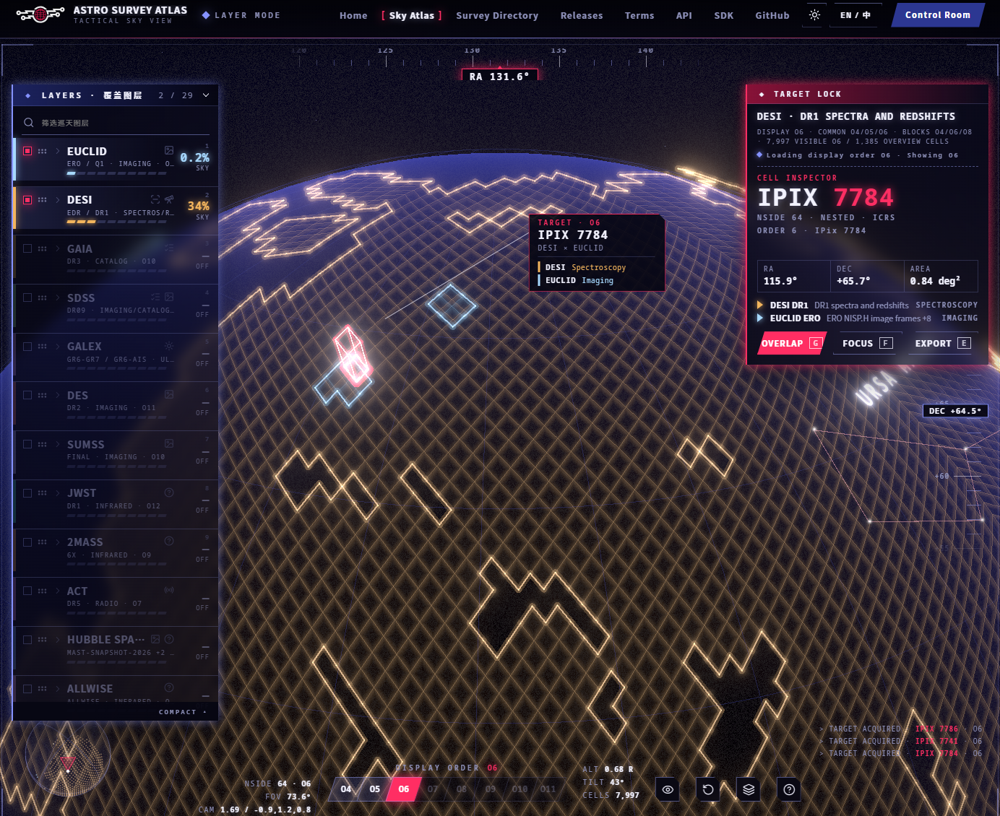
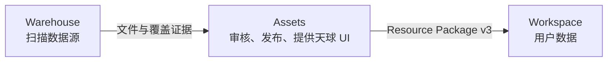

# Astro Survey Atlas · Assets

**查看一片天区被哪些公开巡天覆盖、彼此在哪里重合，以及每个结果来自哪个档案。**

[](https://astro.assets.72602.space/atlas/)

[**打开天球图册**](https://astro.assets.72602.space/atlas/) ·
[巡天目录](https://astro.assets.72602.space/surveys/) ·
[API 参考](https://astro.assets.72602.space/api-docs/) ·
[发布版本](https://astro.assets.72602.space/releases/)

[English](README.md) · Apache-2.0 · Node ≥ 22

---

## 它能做什么

- **覆盖**：打开巡天图层，天球上显示它们真实的 HEALPix 单元。点选一个单元，
  可以看到它的阶数、位置和背后的产品。
- **重合**：打开两个以上巡天后按 <kbd>G</kbd>，在公共阶数下计算严格交集，
  按连通区域逐个查看并导出。
- **溯源**：每个结果都给出原生单元（Tile、brick、partition、target 或
  observation ID）、来源快照哈希，以及精度是 `exact`、`estimated`、
  `entrypoint-only` 还是 `truncated`。

导出的是 JSON/CSV 来源清单：说明这片天区由什么覆盖、数据存放在哪里。
Assets 不会代你下载科学数据。

## 快速开始

```bash
npm ci
npm run build      # 构建 artifacts、后台与站点
npm start          # 后台与站点，http://127.0.0.1:4180
```

开发时运行 `npm run dev`（后台，`:4180`）和 `npm run dev:site`（带 HMR 的
Vite，`:5174`）。`npm run validate` 执行完整构建与测试。Warehouse 反查还需要
`ASSETS_WAREHOUSE_ES_URL`；没有它时公共几何目录照常可用。

## 数据范围

共 29 个巡天、45 个 release，已发布 MOC 图层超过 100 个。实时数字见
`GET /api/v1/status` 和[巡天目录](https://astro.assets.72602.space/surveys/)。

| 巡天 | 原生单元 | 现状 |
| --- | --- | --- |
| Euclid | Q1 MER Tile、Q1_R1 帧、ERO target | Q1 清单 352 个 Tile；ERO 帧最高原生阶 10（estimated） |
| DESI | Tile 候选、官方目录 | 目录可达；Tile 镜像路径尚未核验 |
| Legacy Surveys | DR1–DR10 brick | DR10 South 与官方 366,912 个 brick 清单一致 |
| Gaia DR3 | `gaia_source` HEALPix 分区 | O8 分区定位源文件，不代表天体分布 |
| HST | Observation ID、`s_region`、MAST 入口 | 有界补充；产品与访问政策由 MAST 负责 |

这些范围有边界、有证据，但不是各档案的完整清单。数字、日期与限制见
[docs/data-scope.md](docs/data-scope.md)。

## 工作方式



Assets 把审核过的扫描证据生成原生 MOC、预览和查询块，记录 SHA-256 清单；
版本只有经过审核并在网站上核验后才会发布。原始证据留在对象存储，不进入浏览器。
[Warehouse](https://github.com/Astro-Survey-Atlas/Warehouse) 负责扫描；
[Workspace](https://github.com/Astro-Survey-Atlas/Workspace) 保存用户数据，
不会写回 Assets。

## API

| 端点 | 返回 |
| --- | --- |
| `GET /api/v1/surveys`、`/products` | 巡天元数据与产品 dossier |
| `GET /api/v1/coverage/catalog` | 图层、revision 与 MOC 指针 |
| `GET /api/v1/coverage/surveys/{id}/healpix?order=4` | 分页公共单元 |
| `POST /api/v1/coverage/overlap`、`/overlap/details` | 交集与连通区域 |
| `POST /api/v1/coverage/reverse-lookup` | 文件、tile 与入口匹配 |
| `GET /api/v1/openapi.json`、`/status` | OpenAPI 文档与服务状态 |

匿名访问只是有限预览；完整反查、翻页和导出需要 `region:query` API Key。
在线试用：[/api-docs/](https://astro.assets.72602.space/api-docs/)。

## 发布版本

公共数据以版本化的 Resource Package v3 归档发布（MOC、footprint 投影、
provenance）并附目录清单，列在 [/releases/](https://astro.assets.72602.space/releases/)。
代码和数据分开打 tag：`code-vX.Y.Z` 对应代码，`data-vX.Y.Z` 按 SHA-256
固定一个不可变的数据包。Git 只保存小型可审阅元数据，大文件在对象存储。

## 基本原则

- 不代用户下载科学数据。
- 没有下载链接时，已知来源依然可见；不虚构文件或链接。
- 只有解码后原生阶数不低于 4 的 MOC 才会发布。
- CSST 私有数据属于 Workspace，不进入 Assets。

## 文档

| 主题 | 文档 |
| --- | --- |
| 文档索引与留存规则 | [docs/README.md](docs/README.md) |
| 覆盖配方与发布 | [docs/coverage-workflow.md](docs/coverage-workflow.md) |
| API 契约 | [docs/api-reference.md](docs/api-reference.md) |
| 原生单元管理 | [docs/native-unit-management.md](docs/native-unit-management.md) |
| 存储与证据边界 | [docs/public-artifact-storage.md](docs/public-artifact-storage.md) |
| Resource Package 集成 | [docs/resource-package-integration.md](docs/resource-package-integration.md) |
| 项目边界 | [docs/architecture-boundary.md](docs/architecture-boundary.md) |
| 当前状态与待办 | [HANDOFF.md](HANDOFF.md) |

部署使用 `charts/astro-survey-atlas-assets` 中的 Helm chart。目前仅维护 72602 prod，
版本检查清单与环境边界见 [HANDOFF](HANDOFF.md)。经授权升级前先核对实际 release
values 和 site/backend 镜像覆盖，不将旧 Dev 命令作为生产操作指令。

## 仓库结构

```
server/     HTTP API、发布流水线、原生单元管理
site/       Vite 页面：首页、天球、巡天、发布、条款、文档、管理台
artifacts/  已审阅的注册表、目录投影、证据索引
charts/     Helm chart
docs/       契约、证据记录、研究笔记
scripts/    采集、构建、校验、浏览器测试
test/       Node 与 Python 测试
```

## 许可证

Apache License 2.0，见 [LICENSE](LICENSE) 与 [NOTICE](NOTICE)。本项目属于
[Astro Survey Atlas](https://github.com/Astro-Survey-Atlas) 组织，不是 Apache
Software Foundation 项目。
