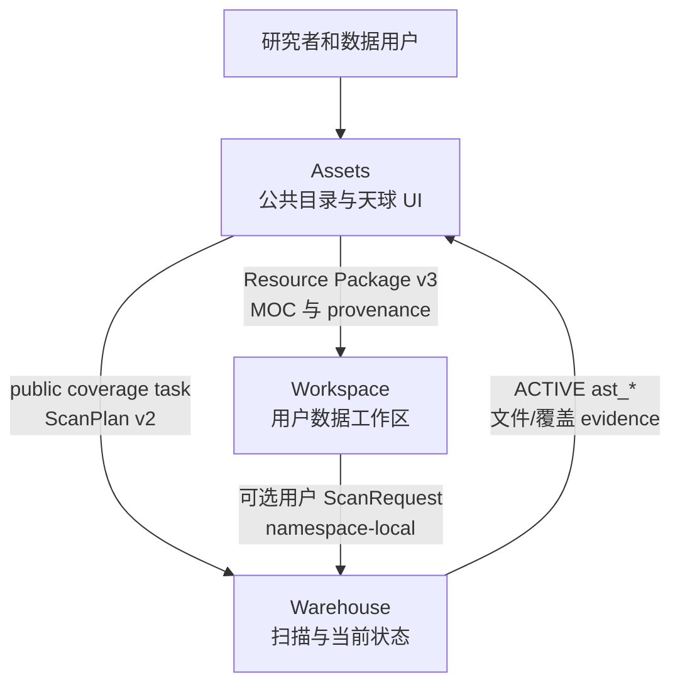
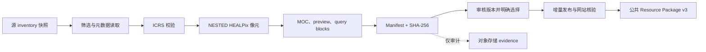

# Astro Survey Atlas · Assets

**给定天区，找出覆盖它的公开巡天，比较重合区域，并把每个结果追溯到原始档案。**

[](https://astro.assets.72602.space/atlas/)

[**打开天球图册**](https://astro.assets.72602.space/atlas/) ·
[巡天目录](https://astro.assets.72602.space/surveys/) ·
[API 参考](https://astro.assets.72602.space/api-docs/) ·
[发布版本](https://astro.assets.72602.space/releases/)

[English](README.md) · Apache-2.0 · Node ≥ 22

---

## 它能做什么

### 1 · 按天区查覆盖


在图层列表里勾选巡天，读取每个 HEALPix 单元的真实阶数、它背后的产品以及已发布的
天区比例。覆盖来自原生 MOC，而不是把粗粒度概览上采样后冒充精细结果。

### 2 · 巡天之间的重合


选中两个以上巡天后按 <kbd>G</kbd>。Assets 计算公共 HEALPix 阶数、在每个巡天内
合并产品，返回可点击、可翻页、可导出的连通区域。

### 3 · 追溯到原生单元


每个结果都带 Tile、brick、partition、target 或 observation ID、来源快照哈希，
以及 `exact` / `estimated` / `entrypoint-only` / `truncated` 之一的确切精度，
并给出官方档案入口。

导出的是**来源清单**（JSON/CSV）：列出该区域由什么覆盖、数据存放在哪里，而不是下载科学数据。

## 快速开始

```bash
npm ci
npm run build      # 构建 artifacts、后台与站点
npm start          # 后台与站点，http://127.0.0.1:4180
```

开发时 `npm run dev` 监听 `:4180` 的后台，`npm run dev:site` 在 `:5174` 启动
带 HMR 的 Vite（把 `/api/` 代理到后台）。`npm run validate` 执行完整构建与测试。
Warehouse 反查额外需要 `ASSETS_WAREHOUSE_ES_URL`；没有该变量时，静态公共几何目录仍可使用。

## 数据范围

已登记 29 个巡天、45 个 release，已发布 MOC 图层超过 100 个。实时数字始终以
`GET /api/v1/status` 和[巡天目录](https://astro.assets.72602.space/surveys/) 为准。
其中原生单元绑定最完整的是：

| 巡天 | 原生单元 | 实际情况 |
| --- | --- | --- |
| Euclid | Q1 MER Tile、Q1_R1 校准帧、ERO target | Q1 锁定 BGSUB 清单 2,908 行 / 352 个 Tile，另有 2,449 行的校准帧快照；ERO frame MOC 最高原生阶为 10，精度为 estimated |
| DESI | Tile 候选与官方目录 | 已记录目录可达性；Tile 级镜像路径尚未核验 |
| Legacy Surveys | DR1–DR10 brick 与候选产品 URI | DR10 South 对应官方 366,912 个成员；北区保留 DR9 North 身份 |
| Gaia DR3 | `gaia_source` HEALPix 分区 | O8 分区描述 source-ID 文件，不代表天体实际占据 |
| HST | Observation ID、原始 `s_region`、MAST 入口 | 有界观测补充；实时产品与访问政策由 MAST 负责 |

这些是有边界、基于证据的范围，不是各档案的完整产品清单。每项数字、记录日期、
CASDC 镜像核对与其余限制见 **[docs/data-scope.md](docs/data-scope.md)**。

## 架构





Assets 决定哪些结果进入公共发布并负责展示。[Warehouse](https://github.com/Astro-Survey-Atlas/Warehouse)
枚举已配置的数据源并报告规范化的文件/覆盖证据；[Workspace](https://github.com/Astro-Survey-Atlas/Workspace)
在自己的数据面保存用户数据，绝不把用户记录写回 Assets。

## API

| 端点 | 返回 |
| --- | --- |
| `GET /api/v1/surveys`、`GET /api/v1/products` | 已审阅的元数据与产品 dossier |
| `GET /api/v1/coverage/catalog` | 天球 UI 使用的图层、revision 与已发布 MOC 指针 |
| `GET /api/v1/coverage/surveys/{surveyId}/healpix?order=4` | 由已发布原生 MOC 派生的分页公共像元 |
| `POST /api/v1/coverage/overlap`、`/overlap/details` | 公共阶数的交集与连通区域 |
| `POST /api/v1/coverage/reverse-lookup` | 有界的文件、tile 与入口反查，快照分页 |
| `GET /api/v1/openapi.json`、`GET /api/v1/status` | OpenAPI 文档与服务可用性 |

完整反查、继续翻页和完整导出需要 `region:query` API Key；匿名预览有限。
交互式参考见 [/api-docs/](https://astro.assets.72602.space/api-docs/)。

## 发布版本

公共数据以版本化 **Resource Package v3** 归档发布（MOC、footprint 投影、provenance、
包说明）外加目录清单。浏览入口：[/releases/](https://astro.assets.72602.space/releases/)。
Git 只保存小型的可审阅元数据；大型 MOC、资源包和 evidence 存放在生产对象存储，
HTTP 只提供已校验的 `/data/current` 目录。

代码与数据分开发布：`code-vX.Y.Z` 代码 tag 不需要对象存储凭据；`data-vX.Y.Z`
数据 tag 按 SHA-256 固定一个不可变公共 bundle。

## 边界声明

- Assets **绝不代替用户下载科学数据**；用户按各档案的访问政策自行获取。
- 即使没有下载链接，已知的来源身份与证据仍然可见；**绝不虚构文件或链接**。
- 运行时只连接配置的 Warehouse Elasticsearch endpoint。
- 输入 manifest、规范化扫描和任务快照属于 evidence，永不进入浏览器初始请求或
  公共 release allowlist。
- 公共 MOC 发布要求解码后的原生最大阶数 ≥ 4，绝不来自上采样预览或请求阶数。
- CSST 私有扫描、输入、输出与预览属于 Workspace，不进入 Assets Git、存储、
  evidence 归档或发布。

## 文档

| 主题 | 文档 |
| --- | --- |
| 覆盖配方、精度与发布 | [docs/coverage-workflow.md](docs/coverage-workflow.md) |
| API 契约 | [docs/api-reference.md](docs/api-reference.md) |
| 原生单元来源、快照、审核与激活 | [docs/native-unit-management.md](docs/native-unit-management.md) |
| 对象存储、evidence 边界与切换 | [docs/public-artifact-storage.md](docs/public-artifact-storage.md) |
| Resource Package 集成 | [docs/resource-package-integration.md](docs/resource-package-integration.md) |
| 项目边界 | [docs/architecture-boundary.md](docs/architecture-boundary.md) |
| 当前实现状态 | [HANDOFF.md](HANDOFF.md) |

部署只使用 Helm chart：

```bash
helm upgrade --install astro-survey-atlas-assets \
  charts/astro-survey-atlas-assets \
  --namespace astro-survey-atlas-assets --create-namespace \
  --values <environment-values.yaml>
```

## 仓库结构

```
server/          HTTP API、发布流水线、原生单元管理
site/            Vite MPA：首页、天球图册、巡天、发布、条款、api-docs、sdk、github、admin
artifacts/       已审阅的公共注册表、catalog 投影与 evidence 索引
charts/          所有部署使用的 Helm chart
docs/            契约、证据记录与研究笔记
scripts/         采集、构建、校验与浏览器测试
test/            Node 与 Python 测试套件
```

## 许可证

Apache License 2.0，详见 [LICENSE](LICENSE) 与 [NOTICE](NOTICE)。本项目属于
[Astro Survey Atlas](https://github.com/Astro-Survey-Atlas) 组织，不是 Apache
Software Foundation 项目。
