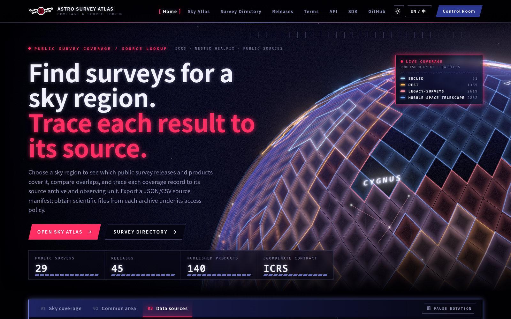
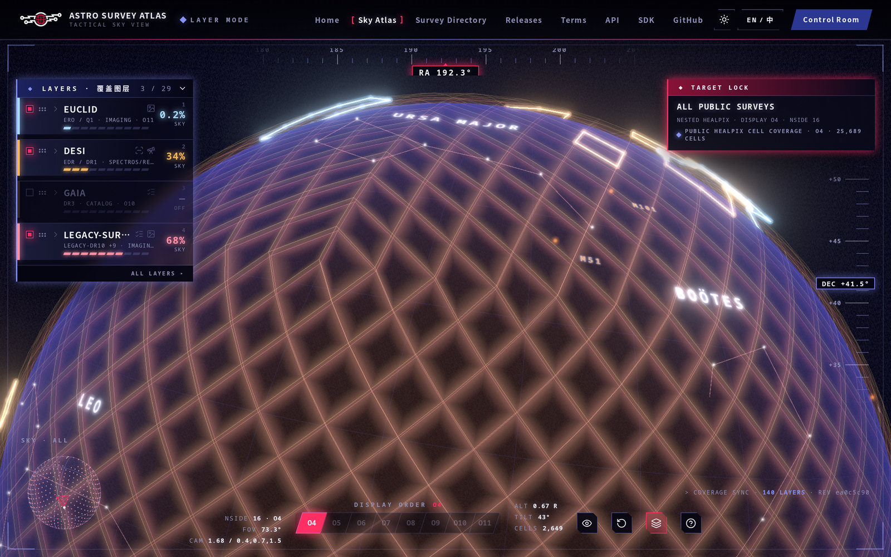
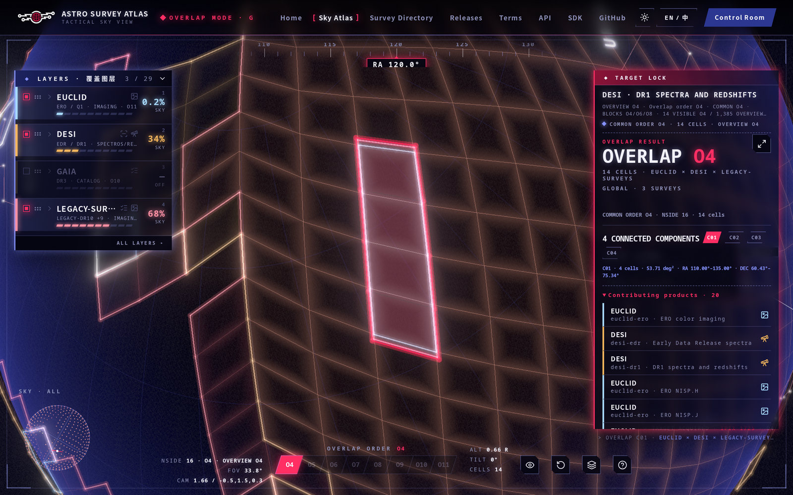
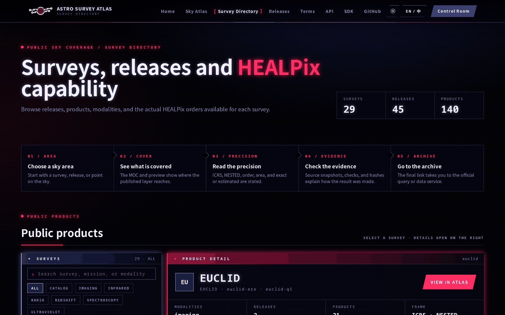
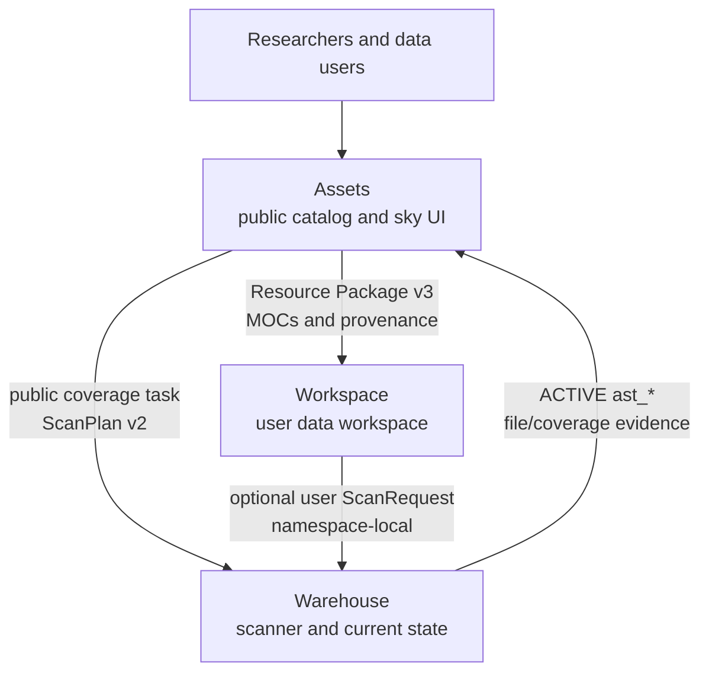
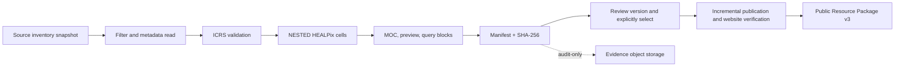

# Astro Survey Atlas · Assets

**Find which public sky surveys cover a region, compare overlaps, and trace every result back to its source archive.**

[](https://astro.assets.72602.space/atlas/)

[**Open the Sky Atlas**](https://astro.assets.72602.space/atlas/) ·
[Survey directory](https://astro.assets.72602.space/surveys/) ·
[API reference](https://astro.assets.72602.space/api-docs/) ·
[releases](https://astro.assets.72602.space/releases/)

[中文说明](README.cn.md) · Apache-2.0 · Node ≥ 22

---

## What it does

### 1 · Coverage by sky region



Pick surveys in the layer roster, then read every HEALPix cell's real order, the
products behind it and their published sky fraction. Coverage comes from native
MOCs — never a coarse overview upsampled to look finer.

### 2 · Overlap between surveys



Select two or more surveys and press <kbd>G</kbd>. Assets computes the common
HEALPix order, unions each survey's products, and returns connected components
you can click, page through and export.

### 3 · Provenance down to the native unit



Each result carries its Tile, brick, partition, target or observation IDs, the
source snapshot hash, one of `exact` / `estimated` / `entrypoint-only` /
`truncated` precision, and the official archive entrypoint.

Exports are **source manifests** (JSON/CSV): they list what covers the region and
where it lives. They are not a download of the science data.

## Quick start

```bash
npm ci
npm run build      # artifacts, server and site
npm start          # API + site on http://127.0.0.1:4180
```

For development, `npm run dev` watches the API on `:4180` and `npm run dev:site`
runs Vite with HMR on `:5174` (proxying `/api/` to the backend). `npm run validate`
runs the full build and test suite. Warehouse-backed reverse lookup additionally
needs `ASSETS_WAREHOUSE_ES_URL`; the static public geometry catalog works without it.

## Data scope

29 surveys are registered across 45 releases, with more than 100 published MOC
layers. Live counts are always in `GET /api/v1/status` and on the
[survey directory](https://astro.assets.72602.space/surveys/). The best-verified
native-unit bindings are:

| Survey | Native units | In practice |
| --- | --- | --- |
| Euclid | Q1 MER Tiles, Q1_R1 calibrated frames, ERO targets | Locked Q1 BGSUB roster (2,908 rows / 352 Tiles) and a 2,449-row frame snapshot; ERO frame MOCs reach native order 10 with estimated bounds |
| DESI | Tile candidates, official directories | Directory reachability is recorded; Tile-level mirror paths are unverified |
| Legacy Surveys | DR1–DR10 bricks, candidate product URIs | DR10 South follows the official 366,912-member roster; north keeps DR9 North identity |
| Gaia DR3 | `gaia_source` HEALPix partitions | Order-8 partitions describe source-ID files, not source occupancy |
| HST | Observation IDs, original `s_region`, MAST entrypoints | Bounded observation supplement; MAST owns current products and access policy |

These are bounded, evidence-backed scopes — not complete inventories of each
archive. Every figure, its date, the CASDC mirror audit and the remaining
caveats are in **[docs/data-scope.md](docs/data-scope.md)**.

## How it works





Assets decides what becomes public and presents it. [Warehouse](https://github.com/Astro-Survey-Atlas/Warehouse)
enumerates configured sources and reports normalized file/coverage evidence.
[Workspace](https://github.com/Astro-Survey-Atlas/Workspace) keeps user data in
its own plane and never publishes user records back to Assets.

## API

| Endpoint | Returns |
| --- | --- |
| `GET /api/v1/surveys`, `GET /api/v1/products` | Reviewed metadata and product dossiers |
| `GET /api/v1/coverage/catalog` | Layers, revisions and published MOC pointers for the sky UI |
| `GET /api/v1/coverage/surveys/{surveyId}/healpix?order=4` | Paginated public cells from published native MOCs |
| `POST /api/v1/coverage/overlap`, `/overlap/details` | Common-order intersections and connected components |
| `POST /api/v1/coverage/reverse-lookup` | Bounded file, tile and entrypoint matches with paged snapshots |
| `GET /api/v1/openapi.json`, `GET /api/v1/status` | OpenAPI document and service availability |

Full lookup, continued paging and complete export need a `region:query` API Key;
anonymous preview is limited. Interactive reference: [/api-docs/](https://astro.assets.72602.space/api-docs/).

## Releases

Public data ships as versioned **Resource Package v3** archives (MOCs, footprint
projection, provenance, README) plus a catalog manifest. Browse them at
[/releases/](https://astro.assets.72602.space/releases/). Git holds small,
reviewable metadata; large MOCs, packages and evidence live in the production
object store, and HTTP serves only the verified `/data/current` tree.

Code and data publish separately: a `code-vX.Y.Z` tag never needs object-store
credentials; a `data-vX.Y.Z` tag pins one immutable public bundle by SHA-256.

## Bounded claims

- Assets **never downloads scientific data** for users. Users retrieve it from
  the source archive under that archive's own access policy.
- Known source identities and evidence stay visible **even without a retrieval
  link**; no file or URL is invented.
- Runtime code reads only the configured Warehouse Elasticsearch endpoint.
- Input manifests, normalized scans and task snapshots are evidence: they never
  appear in the browser's initial request or the public release allowlist.
- Public MOC publication requires an actual native maximum order ≥ 4, decoded
  from cells — never an upsampled preview or a requested order.
- CSST private scans, inputs, outputs and previews belong to Workspace, never to
  Assets Git, storage, evidence archives or releases.

## Documentation

| Topic | Document |
| --- | --- |
| Coverage recipes, precision and publication | [docs/coverage-workflow.md](docs/coverage-workflow.md) |
| API contracts | [docs/api-reference.md](docs/api-reference.md) |
| Native-unit sources, snapshots, review and activation | [docs/native-unit-management.md](docs/native-unit-management.md) |
| Object storage, evidence boundary and cutover | [docs/public-artifact-storage.md](docs/public-artifact-storage.md) |
| Resource Package integration | [docs/resource-package-integration.md](docs/resource-package-integration.md) |
| Project boundaries | [docs/architecture-boundary.md](docs/architecture-boundary.md) |
| Current implementation state | [HANDOFF.md](HANDOFF.md) |

Deployment uses the Helm chart only:

```bash
helm upgrade --install astro-survey-atlas-assets \
  charts/astro-survey-atlas-assets \
  --namespace astro-survey-atlas-assets --create-namespace \
  --values <environment-values.yaml>
```

## Repository map

```
server/          HTTP API, publication pipeline, native-unit management
site/            Vite MPA: home, atlas, surveys, releases, terms, api-docs, sdk, github, admin
artifacts/       Reviewed public registries, catalog projections and evidence index
charts/          Helm chart used for every deployment
docs/            Contracts, evidence records and research notes
scripts/         Acquisition, build, validation and browser smokes
test/            Node and Python test suites
```

## License

Apache License 2.0 — see [LICENSE](LICENSE) and [NOTICE](NOTICE). Part of the
[Astro Survey Atlas](https://github.com/Astro-Survey-Atlas) organization; not an
Apache Software Foundation project.
