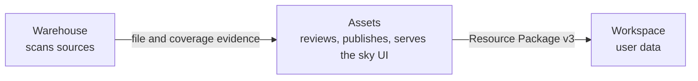

# Astro Survey Atlas · Assets

**See which public sky surveys cover a region, where they overlap, and which
archive each result comes from.**

[](https://astro.assets.72602.space/atlas/)

[**Open the Sky Atlas**](https://astro.assets.72602.space/atlas/) ·
[Survey directory](https://astro.assets.72602.space/surveys/) ·
[API reference](https://astro.assets.72602.space/api-docs/) ·
[Releases](https://astro.assets.72602.space/releases/)

[中文说明](README.cn.md) · Apache-2.0 · Node ≥ 22

---

## What it does

- **Coverage.** Turn on survey layers and the sky shows their real HEALPix
  cells. Pick a cell to see its order, position and the products behind it.
- **Overlap.** With two or more surveys on, press <kbd>G</kbd> for their strict
  intersection at a shared order, split into connected regions you can step
  through and export.
- **Provenance.** Every result names its native unit (Tile, brick, partition,
  target or observation ID), the snapshot hash it came from, and whether it is
  `exact`, `estimated`, `entrypoint-only` or `truncated`.

An export is a JSON/CSV source manifest: what covers the region and where the
data lives. Assets never downloads scientific data for you.

## Quick start

```bash
npm ci
npm run build      # artifacts, server and site
npm start          # API + site on http://127.0.0.1:4180
```

For development, run `npm run dev` (API on `:4180`) and `npm run dev:site`
(Vite with HMR on `:5174`). `npm run validate` runs the full build and tests.
Reverse lookup against Warehouse also needs `ASSETS_WAREHOUSE_ES_URL`; the
public geometry catalog works without it.

## Data scope

29 surveys across 45 releases, with more than 100 published MOC layers. Live
counts are at `GET /api/v1/status` and in the
[survey directory](https://astro.assets.72602.space/surveys/).

| Survey | Native units | Status |
| --- | --- | --- |
| Euclid | Q1 MER Tiles, Q1_R1 frames, ERO targets | Q1 roster of 352 Tiles; ERO frames reach native order 10 (estimated) |
| DESI | Tile candidates, official directories | Directories reachable; Tile mirror paths not yet verified |
| Legacy Surveys | DR1–DR10 bricks | DR10 South matches the official 366,912-brick roster |
| Gaia DR3 | `gaia_source` HEALPix partitions | Order-8 partitions locate source files, not sources |
| HST | Observation IDs, `s_region`, MAST entrypoints | Bounded supplement; MAST owns products and access |

These scopes are bounded and evidence-backed, not full archive inventories.
Figures, dates and caveats: [docs/data-scope.md](docs/data-scope.md).

## How it works



Assets turns reviewed scan evidence into native MOCs, previews and query
blocks, records a SHA-256 manifest, and publishes a version only after it is
reviewed and verified on the site. Raw evidence stays in object storage and
never reaches the browser. [Warehouse](https://github.com/Astro-Survey-Atlas/Warehouse)
runs the scans; [Workspace](https://github.com/Astro-Survey-Atlas/Workspace)
keeps user data and never writes it back to Assets.

## API

| Endpoint | Returns |
| --- | --- |
| `GET /api/v1/surveys`, `/products` | Survey metadata and product dossiers |
| `GET /api/v1/coverage/catalog` | Layers, revisions and MOC pointers |
| `GET /api/v1/coverage/surveys/{id}/healpix?order=4` | Paged public cells |
| `POST /api/v1/coverage/overlap`, `/overlap/details` | Intersections and connected regions |
| `POST /api/v1/coverage/reverse-lookup` | File, tile and entrypoint matches |
| `GET /api/v1/openapi.json`, `/status` | OpenAPI document and service status |

Anonymous use is a limited preview; full lookup, paging and export need a
`region:query` API key. Try it at [/api-docs/](https://astro.assets.72602.space/api-docs/).

## Releases

Public data ships as versioned Resource Package v3 archives (MOCs, footprint
projection, provenance) with a catalog manifest, listed at
[/releases/](https://astro.assets.72602.space/releases/). Code and data are
tagged separately: `code-vX.Y.Z` for code, `data-vX.Y.Z` pinning one immutable
bundle by SHA-256. Git holds only small reviewable metadata; large files live
in the object store.

## Ground rules

- No scientific data is downloaded on a user's behalf.
- Known sources stay visible without a retrieval link; no file or URL is invented.
- A MOC is published only if its decoded native order is at least 4.
- CSST private data belongs to Workspace and never enters Assets.

## Documentation

| Topic | Document |
| --- | --- |
| Documentation index and retention | [docs/README.md](docs/README.md) |
| Coverage recipes and publication | [docs/coverage-workflow.md](docs/coverage-workflow.md) |
| API contracts | [docs/api-reference.md](docs/api-reference.md) |
| Native-unit management | [docs/native-unit-management.md](docs/native-unit-management.md) |
| Storage and evidence boundary | [docs/public-artifact-storage.md](docs/public-artifact-storage.md) |
| Resource Package integration | [docs/resource-package-integration.md](docs/resource-package-integration.md) |
| Project boundaries | [docs/architecture-boundary.md](docs/architecture-boundary.md) |
| Current state and TODO | [HANDOFF.md](HANDOFF.md) |

Deploy with the Helm chart under `charts/astro-survey-atlas-assets`.
Only 72602 prod is maintained; see [HANDOFF](HANDOFF.md) for the release/version
checklist and environment boundary. Inspect the actual release values and
site/backend image overrides before any authorized upgrade; do not reuse old
Dev commands as production instructions.

## Repository map

```
server/     HTTP API, publication pipeline, native-unit management
site/       Vite pages: home, atlas, surveys, releases, terms, docs, admin
artifacts/  Reviewed registries, catalog projections, evidence index
charts/     Helm chart
docs/       Contracts, evidence records, research notes
scripts/    Acquisition, build, validation, browser smokes
test/       Node and Python tests
```

## License

Apache License 2.0; see [LICENSE](LICENSE) and [NOTICE](NOTICE). Part of the
[Astro Survey Atlas](https://github.com/Astro-Survey-Atlas) organization, not an
Apache Software Foundation project.
