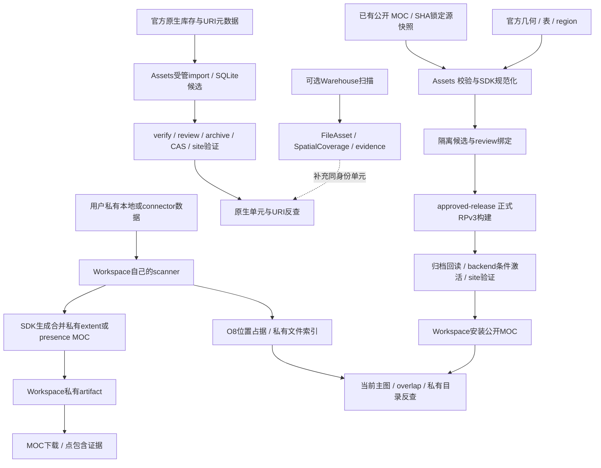

# ASA 数据生产链、MOC 与原生单元 provenance 审计（2026-11-14）

本阶段只审计、运行安全本地验证并提出 DR1 方案；未修改既有科学算法、生产数据、Helm、Secret、authority pointer 或活动 Native Unit，未创建 GCP 资源、部署 Warehouse 或实施 DR1 导入。所有远程科学影像、光谱及 Cube 正文下载为 0 字节；FITS MOC 是覆盖元数据，另行记录。

## 结论与验证边界

Assets 已有两条独立的生产线：公开覆盖 MOC/Resource Package，以及官方原生单元/URI 的受管 SQLite。前者不能替代后者。Warehouse 提供可选扫描与文件证据，Workspace 有自己的扫描、索引和私有 MOC 生成能力；不需要为所有路径新部署 Warehouse，也无需重新设计 SDK。

本次发现的实际差距：

- **私有影像覆盖未接入主图和交集。** 保存的是完整 WCS image extent MOC，但主图/overlap 明确选择 O8 位置占据。真实 SDK + 本地 API 合成对照得到 97 格 extent、1 格主图、1 格交集；WCS 仍用于精确点包含。这是现有代码及回归测试支持的语义选择，相对用户要求仍是能力缺口，不能只改标签。
- **四仓库 main 不是已证明兼容的部署组合。** Warehouse 当前 HEAD 拒绝 Assets 可发出的 path-healpix 及新增 catalog HDU 字段，亦无 ScanBatchRequest 等实现。已用真实 parser/validator 合成探测，不据此断言生产故障。
- **DR1 Cube 官方 MOC 存在，但实际 O0 全天表示被当前 O4 gate 拒绝。** 已用真实官方字节、SDK 和 Assets gate 验证；不能相信 header O11 或放大投影绕过。
- **可重建证据分散在多个产物。** 正式包 provenance 不是自包含的完整源码/输入锁；需关联 Assets evidence、源码快照和 wheel SHA。CLI 的版本字符串也不足以识别实际 SDK distribution。
- **线上 commit 尚不能确认。** 公开 health、自述交接和 main 版本不同；只读状态与一个实际 QR2 公开包的完整性验证通过，不代表写入型发布或生产全流程验收。

下面明确区分三种证据：**静态代码追踪**、**本地执行通过/失败**、**生产只读 HTTP/公开包检查**。本地 fixture/mock 不能替代生产验收。

## 固定代码快照与线上观察

起始记录见 [repository-baseline.json](evidence/20261114/repository-baseline.json)，四仓库均为新克隆 main，`git status --porcelain=v1` 为空，初始没有用户未提交修改。各自 README/HANDOFF/CONTEXT/AGENTS 在存在时均已阅读；Assets 指定 Coverage Workflow 技能和工作流文档已读，文档只作约束与定位，结论由代码复核。

| 仓库 | 审计 HEAD | 实际实现定位 |
| --- | --- | --- |
| Assets | `8ff160f83d568221abe6cd771ab81b318dd85ea1` | package/health 源码 0.0.13；Docker 默认固定 SDK1.2.0 wheel+dirty source snapshot |
| Warehouse | `2e1850d93a87a05b7497caa0dae6c687c22e36e3` | Java HEALPix，固定 SDK conformance fixture；不是 Python SDK runtime |
| Workspace | `c7658f05e629e0a6468b57668d5c732beab65d82` | Docker 默认固定 SDK1.0.0 wheel，自有 SQLite/ES/worker |
| MOC-Core-SDK | `16dbd7ea301777848ae16d56bd2a520438893aaf` | distribution1.1.0，不等于上述两个消费者 |

所有代码链接固定到这些 SHA；`snapshot:core.py` 的行号特指 Assets vendored tar.gz 内部源码，关联 SHA 在 SDK 一节，不将它误链到 upstream main。

2026-11-14 北京时间约19:38–19:46，只读检查公开域名：

| 观察 | 实际响应 | 能确认与不能确认 |
| --- | --- | --- |
| `/healthz` | HTTP200，version **0.0.11**；bundle `reviewed-mupsxe2v-c91be91f`，603 files，SHA `0e49b04b57e482f98fd2028ce55fa1a482d7b6f5318142845dc8c0bb30b4b307`；native为backend-proxy | health 是 site/proxy 的自报版本；不能据此确定 backend commit/image/SDK，更不能擅自解释为降级 |
| `/api/v1/status` | HTTP200；publishedMocLayers=105；native `803023a36a8d489d951717214b92d0df4c3d4b7b36607a3634843bb0621d29d5`、generation4、managed/verified；reverse-lookup available；Warehouse geometry/evidence均unconfigured | 原生单元服务在未配置 Warehouse evidence 时仍自报可用；没有实测认证完整分页/每个binding |
| `/api/v1/coverage/catalog` | HTTP200；132个可显示/查询图层、29 surveys | 与105个 published MOC、Git离线80条build不同作用域；不能混用三个计数 |
| `/api/v1/resource-packages/catalog.json` | HTTP200；28 packages；SPHEREx仍为QR2 3.1.0 | 一次冻结公开目录；不证明后端所有输入证据均可恢复 |
| 实际SPHEREx公开包 | 76,056B，外层SHA `bd60d78213456d56cfc2854104f6bcfb1b65600f1000360ea4a6e4a804c382e8` 与目录一致；7层QR2 MOC最高O7、O8明确omitted | 目录+外层+所有受声明成员/SDK严格内层验证通过；不是DR1，不是生产安装wheel的证明 |

HANDOFF称生产0.0.12，main源码为0.0.13，在线health为0.0.11，三者保留原值；未读取集群/镜像digest，没有将main当线上。原始JSON、HTTP状态与时间见 [production/](evidence/20261114/production/)。误试无此路由的 `/api/v1/resource-packages` 返回404，随后按当前源码改查上述catalog.json；不据此报告服务故障。

## 三条实际生产线与项目边界



私有路径、文件ID、header、扫描证据和私有MOC留在Workspace。向Assets做公开native反查时仍会发送所选天区的order/cells及公开layer/cursor；这不等于所有空间选择均不离开Workspace。公开库存和反查结果不作为Workspace共享公共索引持久化，公开MOC安装与用户确认的科学下载任务是另行允许的边界。

## 七类产物逐项区分

| 产物 | 生成者与内容 | 位置/身份与边界 |
| --- | --- | --- |
| 原始官方/提供方 FITS MOC | IRSA、CDS/HiPS等提供空间NUNIQ覆盖；CDS第三方MOC不自动等于巡天官方mask | Assets source.moc或离线锁定evidence；原始SHA/size/URL保留；不含完整native单位/文件清单 |
| SDK规范化 FITS MOC | Assets worker/SDK canonicalize、必要时coarsen；几何recipe则从真实表/region/WCS重算 | moc-build staging、MOC publication候选、正式包mocs/；输入SHA与输出SHA不是同一件事；SDK无发布权 |
| O4/O8 HEALPix投影 | SDK/Assets从MOC生成JSON，O4概览/O8查询；正式sidecar对真实阶不足的层显式omit | query-order8/preview-order4或healpix/order4/8；是投影，不是原生科学分块，展开不增加精度 |
| Resource Package v3 | 正式publisher的buildApprovedRelease生成ZIP，含MOC、footprint、两阶sidecar、manifest/provenance/README | public内容寻址对象与不可变版本；独立于native SQLite；不包含科学payload或完整URI库存；需审核与authority/site验证 |
| Native Unit SQLite | Assets由官方库存/足迹/分区+真实URI建立单位、membership、O4候选/分区索引 | managed native-units indexes，独立review/archive/CAS pointer；MOC可筛天空但不能恢复任意observation/文件存在性 |
| Warehouse FileAsset/SpatialCoverage | Scanner从真实文件/目录提取文件记录与显式order/ipix覆盖边，Java HEALPix | 配置ES的file/layer/coverage索引+evidence；是扫描范围，不是全巡天库存，不产生正式RP |
| Workspace私有MOC | 自有worker调用固定SDK，由私有WCS或catalog生成并合并 | user-mocs/layer/run私有FITS/JSON/provenance，active batch控制；完整extent保存不等于已用于主图/overlap |

## 公开 MOC → 正式 Resource Package 与发布

### 先纠正三个容易混淆的名称

- `MocPublicationStore.publish()`（[server/moc-build.ts:779](https://github.com/Astro-Survey-Atlas/Assets/blob/8ff160f83d568221abe6cd771ab81b318dd85ea1/server/moc-build.ts#L779)）把 STAGED 文件复制到 contentRoot/moc-releases 并记录候选，**不是对外发布点**。[server/server.ts:865-873](https://github.com/Astro-Survey-Atlas/Assets/blob/8ff160f83d568221abe6cd771ab81b318dd85ea1/server/server.ts#L865) 的 `prepareProductGeometry` 注释及调用明确只为 review 准备可验证的候选；只有 approved snapshot 能授予公开访问。
- `DynamicResourcePackageStore.sync()`（[server/resource-package-publication.ts:481](https://github.com/Astro-Survey-Atlas/Assets/blob/8ff160f83d568221abe6cd771ab81b318dd85ea1/server/resource-package-publication.ts#L481)）可从 MOC publication 创建并留存动态包，但当前正式整版发布调用 `buildApprovedRelease()`（[server/public-release-publication.ts:835](https://github.com/Astro-Survey-Atlas/Assets/blob/8ff160f83d568221abe6cd771ab81b318dd85ea1/server/public-release-publication.ts#L835) → [server/approved-release.ts:108](https://github.com/Astro-Survey-Atlas/Assets/blob/8ff160f83d568221abe6cd771ab81b318dd85ea1/server/approved-release.ts#L108)）。最终正式包的层、成员、SHA、目录、历史由后者重建（`:189-249`）。不能把动态缓存 sync 当作线上 commit。
- `scripts/rebuild_resource_packages.py` 是离线/维护重建：`:29-38` 定位本地树、`:310-341` 调 SDK `build_resource_package`、`:421` 入口。它保持旧版本、对字节变化增 minor 版、更新本地 catalog；本身不写 authority pointer、不构成公开 release。`package.json` 的 `packages:rebuild` 还调用 provenance hash 和 catalog 构建，依赖 hydrated bytes，不是本次应照搬的上线命令。

### 仓库中锁定的离线覆盖输入，不等于当前线上全部层

从 `src/layers/public-build-plan.json` 的 80 个 entry 和其真实 lock JSON 逐一统计，结果保存在 `evidence/20261114/public-moc/recipe-inventory.json`：

| 输入类别 | 数量 | 判断依据 |
| --- | ---: | --- |
| `native-moc` | 72 | 所有 snapshot.sourceUrl 的主机都是 alasky.cds.unistra.fr；是 CDS/HiPS 提供的覆盖 MOC，不能全部改称巡天官方原生 mask |
| `nested-healpix`，但输入仍是 CDS FITS MOC / STMOC 的空间投影 | 5 | DECaLS DR5、Gaia DR3、KiDS DR5、SkyMapper DR4、VISTA VIKING J；不能凭 mode 名误判为从科学影像重新生成 |
| `tile-table` | 2 | DESI DR1/EDR `TILE_COMPLETENESS`，TILERA/TILEDEC/NEXP>=1，按锁定焦平面圆半径 1.6280324520485583° 建 conservative coverage；并非目标级光谱或真实可用像素 mask |
| `regions` | 1 | Euclid Q1 的 SHA 锁定 DS9 三深场 region ZIP，`q1_edff.reg/q1_edfn.reg/q1_edfs.reg` |

5 个 nested-healpix 的来源锁包括 record SHA、native spatial order 与 exported order。Gaia DR3 是 catalog object presence；其他四个是 HiPS STMOC 的空间投影，时间窗口不保留在 spatial MOC。不能将 catalog presence、图像范围和光谱目标覆盖互换。

`src/layers/layer-registry.json` 当前共 103 entries：80 acquired、1 awaiting_publication、22 awaiting_snapshot。这是 Git 工作树基线，不是生产当前覆盖总数。本次审计已读到生产 HTTP catalog/status 的 105 published MOC layers；本节不把二者拼成同一快照。

### 官方/公开已提供 MOC → Assets 正式 Resource Package

#### 3.1 来源发现与锁定

| 步骤 / 入口 | 执行者、输入输出和持久化 | 哈希、失败与依赖 |
| --- | --- | --- |
| 管理端来源发现 [server/admin.ts:1894](https://github.com/Astro-Survey-Atlas/Assets/blob/8ff160f83d568221abe6cd771ab81b318dd85ea1/server/admin.ts#L1894) / `createMocDiscoveryRequest` | Assets 向 K8s Warehouse `MocDiscoveryRequest` 创建请求；CDS v2 summary 有 candidates/truncated/summaryTruncated | 这条当前 UI discovery 依赖 Warehouse operator/controller。**计算已有 MOC 的服务本身不依赖扫描器。** |
| [server/server.ts:825-827](https://github.com/Astro-Survey-Atlas/Assets/blob/8ff160f83d568221abe6cd771ab81b318dd85ea1/server/server.ts#L825) `discoveryView` / `discoveryCandidate`；[server/moc-discovery.ts:317](https://github.com/Astro-Survey-Atlas/Assets/blob/8ff160f83d568221abe6cd771ab81b318dd85ea1/server/moc-discovery.ts#L317) `resolveMocDiscoveryCandidate` | 只接受返回 summary 中的 candidate ID，源 URL 从权威 summary 取，不相信客户端传 URL。CDS URL 只允许白名单 HTTP(S) 无凭据 | summary 必须 schema v2，最多50条，不支持/缺失时409；可选 LLM fallback 在 Assets 独立服务中处理，但当前接线的 discoveryView 仍先读 Warehouse 请求 |
| [server/server.ts:2770](https://github.com/Astro-Survey-Atlas/Assets/blob/8ff160f83d568221abe6cd771ab81b318dd85ea1/server/server.ts#L2770) `createMocBuild`；[server/moc-build.ts:361](https://github.com/Astro-Survey-Atlas/Assets/blob/8ff160f83d568221abe6cd771ab81b318dd85ea1/server/moc-build.ts#L361) `MocBuildStore.create` | 创建持久 `MocBuildRequest` 并 enqueue。状态在 `<contentRoot>/moc-build-requests-v1.json`；内容快照恢复可通过 snapshotSink | 产品/工作项身份与发现请求核对；失败不授予公开可见性 |
| [server/moc-build.ts:561](https://github.com/Astro-Survey-Atlas/Assets/blob/8ff160f83d568221abe6cd771ab81b318dd85ea1/server/moc-build.ts#L561) `process`；`:183` `cdsProductSource` | Node 下载 MOC；CDS/P 产品先保存 `source-record.json`，读取真实 moc_order，将 exportOrder=min(nativeOrder, configuredMaxOrder)，再取 smoc。源字节写 `<evidenceRoot>/moc-build/<safe-name>/source.moc` | URL白名单、公网来源检查；默认256MiB上限。写入 `wx`，已有不同内容拒绝。source SHA/size/ref 经 `lockSnapshot`(:453) 持久化，同产品/源 SHA 去重成 DUPLICATE。**只下载 MOC/记录元数据，不获取科学影像。** |

#### 3.2 计算及证据

[server/moc-build.ts:903](https://github.com/Astro-Survey-Atlas/Assets/blob/8ff160f83d568221abe6cd771ab81b318dd85ea1/server/moc-build.ts#L903) `PythonMocCoreRunner` 用子进程执行 `scripts/moc_build_worker.py`，传 `MOC_BUILDER_PYTHON` / `MOC_BUILDER_SCRIPT`；开发默认把 sibling MOC-Core-SDK 加到 PYTHONPATH，部署应以 Dockerfile 安装的锁定 wheel 为证。不能因开发 main 可导入就认为与生产相同。

Python worker 的实际任务：

- [scripts/moc_build_worker.py:37](https://github.com/Astro-Survey-Atlas/Assets/blob/8ff160f83d568221abe6cd771ab81b318dd85ea1/scripts/moc_build_worker.py#L37) `validate` 调 SDK `validate_moc_fits`，校验 FITS/ICRS/NUNIQ 并报告解码得到的实际 orders。
- `:43` `build` 调 `read_moc_fits`、`canonical_cells(max_order)`、`write_moc_fits`，输出规范 FITS `moc.fits`；同时输出 `query-order8.json`、`preview-order4.json` 和 `statistics.json`。**规范化不是从科学文件重新计算覆盖。**
- 这条已有 MOC 的运行时 build 默认 maxOrder12/query8/preview4（[server/moc-build.ts:539-547](https://github.com/Astro-Survey-Atlas/Assets/blob/8ff160f83d568221abe6cd771ab81b318dd85ea1/server/moc-build.ts#L539)），高阶输入可能被 coarsen；必须保留来源 native 与 export/build 后 actual order，不能混称原始精度。
- query/preview 是 cell-set projection，即使可表达粗格的细格展开，也不增加 native evidence。公开资格由真实 FITS decoded maximum≥O4 决定；[server/coverage-policy.ts:8](https://github.com/Astro-Survey-Atlas/Assets/blob/8ff160f83d568221abe6cd771ab81b318dd85ea1/server/coverage-policy.ts#L8)、`server/approved-release.ts:67-69/141-144` 再核。
- [server/moc-build.ts:868](https://github.com/Astro-Survey-Atlas/Assets/blob/8ff160f83d568221abe6cd771ab81b318dd85ea1/server/moc-build.ts#L868) `outputSummary` 重读输出文件算 SHA/size；`:607-631` 写不可变 build-manifest，source URL/SHA/size、CDS record 与输出引用保留为 evidence。STAGED 后排队异步 snapshot upload。计算完成与上传完成不是同一状态。
- `MocBuildService.verifyOutputs(:518)` 重新读取 source、inputEvidence 和所有输出的真实字节、regular-file/size/SHA，再执行 SDK validation；不能手填 caller hash 通过。
- 错误捕获置 FAILED（`:632-636`）；临时/已落盘不可变 evidence 可保留诊断，但不改变已公开 snapshot。进程恢复可重入未终结 build（[server/server.ts:899](https://github.com/Astro-Survey-Atlas/Assets/blob/8ff160f83d568221abe6cd771ab81b318dd85ea1/server/server.ts#L899)）；重试以新尝试状态与不可变冲突校验约束，不能原地换源。

#### 3.3 审核 → 正式包 → 发布

1. **审核**：`POST /api/v1/admin/products/:id/review` 在 [server/server.ts:3327-3342](https://github.com/Astro-Survey-Atlas/Assets/blob/8ff160f83d568221abe6cd771ab81b318dd85ea1/server/server.ts#L3327)。`assertReviewableProduct` 检查非可接受缺口；`prepareProductGeometry` 固定候选；`productGeometry` ([server/approved-release.ts:51](https://github.com/Astro-Survey-Atlas/Assets/blob/8ff160f83d568221abe6cd771ab81b318dd85ea1/server/approved-release.ts#L51)) 以显式 product/layer ID 绑定文件并重读 SHA；`currentReview(:81)` 绑定 policy、product revision/content SHA、geometry revision/MOC SHA/index revision。更改这些任意一项，review失效。
2. **提交发布**：`server/server.ts:3353-3361/3376-3387` → `PublicReleasePublisher.submit(:634)`，要求 planId 与 expectedBaselineSha256 匹配，显式选择已 review 的 product versions（`:639-721`），不接受旧 ACTIVE 标记替代 review。
3. **队列与执行者**：有 management backend+authorityStore+releaseSynchronizer 时挂 `PublicationScheduler`（[server/server.ts:843-863](https://github.com/Astro-Survey-Atlas/Assets/blob/8ff160f83d568221abe6cd771ab81b318dd85ea1/server/server.ts#L843)），SQLite `<contentRoot>/publication/tasks.sqlite`（[server/publication-scheduler.ts:40-55](https://github.com/Astro-Survey-Atlas/Assets/blob/8ff160f83d568221abe6cd771ab81b318dd85ea1/server/publication-scheduler.ts#L40)）。submit冻结选中的产品/审核/所有可用publications（`:117-145`），dedupe selection；lease和attempt fences保留重启语义。scheduler tick `:214-225` fork `publication-executor.ts`，子进程只计算/上传候选，通过 IPC 请求 activation。queue/authority写入者是 backend父进程，子进程无授权发布决策。
4. **真实正式包构建**：`PublicReleasePublisher.execute` → `buildApprovedRelease` ([server/approved-release.ts:108-251](https://github.com/Astro-Survey-Atlas/Assets/blob/8ff160f83d568221abe6cd771ab81b318dd85ea1/server/approved-release.ts#L108))。保留旧 approved products 的冻结MOC，逐个重核sha/native order；所选只用相同revision/currentReview。对发生变化的 survey 创建 stable ID `public-<survey>-footprints`、高于所有 retained minor 的 `3.N.0`；旧包仍可version-pin。
5. **包内容**：[server/approved-release.ts:203-233](https://github.com/Astro-Survey-Atlas/Assets/blob/8ff160f83d568221abe6cd771ab81b318dd85ea1/server/approved-release.ts#L203) 输出 `resource-package.json`、`mocs/<layer>.moc.fits`、`footprints/survey-footprints.json`、`provenance.json`、README、`healpix/order4.json` 和 `healpix/order8.json`。外层 ZIP 及每层MOC/每个support成员都有SHA/size；实际写入ZIP后重新读取成员核验（`:224-231`）。包不含原生单元SQLite或科学数据URI完整库存。
6. **候选上传与回读**：[server/public-release-publication.ts:847-876](https://github.com/Astro-Survey-Atlas/Assets/blob/8ff160f83d568221abe6cd771ab81b318dd85ea1/server/public-release-publication.ts#L847) 上传 immutable object release，再从对象存储恢复候选并核对release docs。[server/object-release.ts:50-84](https://github.com/Astro-Survey-Atlas/Assets/blob/8ff160f83d568221abe6cd771ab81b318dd85ea1/server/object-release.ts#L50) 只上传变动的内容寻址对象 `public/objects/sha256/<sha>`，相同旧对象复用，manifest在 `public/manifests/<manifestSha>.json`。旧archive引用可仍被manifest继承，不保证所有历史对象都已独立重写。
7. **唯一公开commit点**：父 scheduler再次检查review未变（[server/publication-scheduler.ts:243-254](https://github.com/Astro-Survey-Atlas/Assets/blob/8ff160f83d568221abe6cd771ab81b318dd85ea1/server/publication-scheduler.ts#L243)），`activateObjectRelease`（[server/object-release.ts:128-137](https://github.com/Astro-Survey-Atlas/Assets/blob/8ff160f83d568221abe6cd771ab81b318dd85ea1/server/object-release.ts#L128)）先核对expected baseline，再用ifMatch ETag/ifNoneMatch条件写 `public/current.json`，回读核验pointer。上传/候选失败不会改pointer；激活已成功后site校验失败不会自动回滚authority。
8. **站点应用与验证**：[server/sync-release.ts:224-242](https://github.com/Astro-Survey-Atlas/Assets/blob/8ff160f83d568221abe6cd771ab81b318dd85ea1/server/sync-release.ts#L224) 验证完整候选，安装至按bundle SHA版本化目录，再切current；server runtime同时替换catalog和publicState，失败保留上一个verified snapshot（[server/server.ts:875-886](https://github.com/Astro-Survey-Atlas/Assets/blob/8ff160f83d568221abe6cd771ab81b318dd85ea1/server/server.ts#L875)）。`PublicReleasePublisher.verifySite(:934-1079)` 检查health bundle SHA及products/coverage/package IDs身份。未配置site目标仅authority-published，不算全验收；站点暂未应用是site-pending，可重试核验而不再写pointer。
9. **恢复/不确定激活结果**：[server/publication-scheduler.ts:88-109](https://github.com/Astro-Survey-Atlas/Assets/blob/8ff160f83d568221abe6cd771ab81b318dd85ea1/server/publication-scheduler.ts#L88) 重启读authority确认candidate是否已经commit，authority不可达时不把超时当未commit。过期attempt拒绝晚到activation，只有明确transport errors自动重试，永久失败需显式处理。没有安全的“失败就随意回写旧current”自动回滚。

整条已有 MOC 的计算/审核/package代码没有 Warehouse scanRun 作为硬参数。当前 UI 的**发现入口**依赖 Warehouse CRD；已锁定离线build、已登记evidence build和正式打包不是科学文件扫描，不应该为计算一个已有MOC先部署Warehouse。

### 官方原生几何 → MOC 的额外入口

- 离线80层中仅前述DESI两表/Euclid一区域明示从几何算覆盖；运行时新增的HST/Euclid/path-HEALPix不能由这80条统计代替。
- [server/evidence-moc-import.ts:198](https://github.com/Astro-Survey-Atlas/Assets/blob/8ff160f83d568221abe6cd771ab81b318dd85ea1/server/evidence-moc-import.ts#L198) `registerEvidenceMoc` 是**特定HST MAST**导入：读取SHA锁定MAST CAOM snapshot/input manifest/provenance/DS9 region/recipe，要求 `s_region` STC-S POLYGON → DS9 且 `ICRS/NESTED`，precision=estimated、completeness=incomplete、scienceFileScan=not-scanned（`:205-285`）；核对输出真实FITS/order/query/preview/statistics/hash（`:287-329`），不可变staging后注册产品与verified build，最后再调用verifyOutputs（`:333-418`）。不能把它当任意外部geometry的无约束导入器。
- worker `build_regions` ([scripts/moc_build_worker.py:74-154](https://github.com/Astro-Survey-Atlas/Assets/blob/8ff160f83d568221abe6cd771ab81b318dd85ea1/scripts/moc_build_worker.py#L74)) 要 regions模式、ICRS/NESTED、maxOrder≥4、queryO8/previewO4、本地安全路径、snapshot SHA、限定的HST或managed Euclid source身份；调用SDK build_layer(rebuild=True)；实际native至少O4且>=queryOrder，不接受声称order12但真实更粗的输出。
- 当前 managed-native Euclid例外限定source IDs为 `euclid-ero-targets/euclid-q1-calibrated-frames/euclid-q2-egbs-quadrants`，需要snapshot和nativeVersion SHA、frameCount。DR1 SPHEREx 不可只换source ID复用此入口。
- 相关管理route还包括 [server/server.ts:3127-3139](https://github.com/Astro-Survey-Atlas/Assets/blob/8ff160f83d568221abe6cd771ab81b318dd85ea1/server/server.ts#L3127) native-unit / evidence / path-healpix import，须按各自source-specific校验，不是一个可任意声明“官方精确”的通用口。

### 实际验证与明确边界

执行环境：Node v24.22.1，Assets npm ci --ignore-scripts 成功（本次审计安装）。本审计不调用production写API、不修改科学算法、不hydrate历史业务数据。

### A. 已执行的本地测试

命令一（完整日志 `evidence/20261114/public-moc/node-tests.log.gz`）：

```sh
node_modules/.bin/tsx --test --test-concurrency=2 \
  test/moc-discovery.test.ts test/resource-package-publication.test.ts \
  test/resource-package-projection.test.ts test/public-release-publication.test.ts \
  test/evidence-moc-import.test.ts test/product-restoration-publication.test.ts
```

结果34 tests：31 pass，3 fail，0 skipped。3失败都来自 `resource-package-publication.test.ts` 读取未hydrate的历史Euclid MOC，ENOENT：`artifacts/public-survey-footprints/layers/euclid-q1-deep-fields-image-extent/euclid-q1-deep-fields-image-extent.moc.fits`。不能宣称全部测试绿，也不能宣称这3条断言证实算法故障。未从线上补齐历史业务数据。动态缓存store的fixture-dependent测试仍未完成。

31条已通过中包括：

- CDS v2候选、source snapshot去重、source record native order（Core runner在该用例是注入mock，不冒充真实SDK计算）；
- HST provenance/DS9变更拒绝、真实native O4最低阶检查；
- staged/published output immutability、tampered SHA拒绝和snapshot restore；
- 真正 `buildApprovedRelease` 本地合成MOC→v3 ZIP所有内容/sidecarSHA→filesystem-backed S3 mock→pointer→syncRelease→publicState完整链；
- reviewed revision / missing frozen geometry / tampered geometry拒绝，撤下/恢复/重新review/发新包；
- deterministic collection和manifest读取。

命令二（完整日志 `evidence/20261114/public-moc/scheduler-tests.log.gz`）：

```sh
node_modules/.bin/tsx --test --test-concurrency=2 \
  test/publication-scheduler.test.ts test/publication-task-store.test.ts
```

7/7 pass，包含 **real IPC executor** + localhost S3 HTTP fixture + parent activation + separate site-pending；lease expiry、attempt fencing、restart、dedupe、只对transient errors 5/15/45秒最多三次重试。属于安全本地fixture端到端，不是production发布验收。

合计41 tests：38 pass / 3 fixture ENOENT fail。

### B. 一个真实线上公开包的只读验证

本次审计从公开catalog获得SPHEREx QR2 RP `public-spherex-footprints@3.1.0`、外层size/SHA并下载几何包76056 bytes（不是科学数据）。随后运行 `evidence/20261114/public-moc/verify-live-package.mts`，调用当前Assets的 `readResourcePackageManifest`、`readZipEntry`、`decodeNativeMoc`，对全部12个支持/MOC成员验证真实size/SHA，对7个MOC核实declared maxOrder=actual maxOrder=7。

结果：7层color+D1–D6均release `spherex-qr2`。O4有7层、union3072格（仅这个显示阶数上的全天全覆盖，不代表每个空间/光谱sample都有科学有效数据）；O8的layers=[]、surveyUnion.cells=[]且surveyUnion.omittedLayers有7条native O7不能O8原因。`provenance.json`实际method全部native-moc、CDS QR2 smoc来源，reviewedAt为2026-09-26；不把它改称DR1。

另用锁定SDKAssets锁定1.2.0的`validate_resource_package`严格校验全部13 ZIP entries通过（含manifest本身），outer SHA为`bd60d78213456d56cfc2854104f6bcfb1b65600f1000360ea4a6e4a804c382e8`；其SDK校验未传catalog，外层目录信任仍以本次审计观察catalog匹配为准。证据：`evidence/20261114/public-moc/live-spherex-package-verification.json`、`.log.gz`、`.mts`，及`evidence/20261114/sdk/sdk-path-results.json`的`production_qr2_package`。这是一次真实线上**公开包只读完整性**验证，不是生产镜像校验、管理审核写流程或全105层来源独立重建。

### 审计发现与未完成项

1. **正式包构建组件需要说准确**：当前整版发布是 `approved-release.ts/buildApprovedRelease`，而非单靠离线rebuild或dynamic package sync。这是解释生产链的核心纠正。
2. **来源权威不要泛化**：离线77个MOC输入来自CDS；提供方是CDS/HiPS，不自动等于巡天官方mask。每层需依它的sourceTier/authority与release身份解释。HiPS color不是单波段selection mask；catalog点presence不是image coverage。
3. **RP provenance非自包含重建合同**：[server/approved-release.ts:209](https://github.com/Astro-Survey-Atlas/Assets/blob/8ff160f83d568221abe6cd771ab81b318dd85ea1/server/approved-release.ts#L209) 的正式包provenance只保存productRevision、reviewedAt、geometrySourceUrl、geometryRevision、mocSha256、method、indexRevision，不带sourceSnapshotSha256、SDK版本或完整recipe。它们保存在Assets build-manifest/locked inputs/content evidence；本次线上QR2包也确认如此。不能说“单独拿一个RP即可完整按锁输入重建”。不携带原始evidence本身符合存储边界，但必须有可关联证据才能复现。
4. **精度表达保守但不同路径不一致**：正式 `approved-release.ts:208` 把layer.geometryPrecision硬编码estimated；dynamic publisher按product.coverageEvidence.precision（[server/resource-package-publication.ts:610](https://github.com/Astro-Survey-Atlas/Assets/blob/8ff160f83d568221abe6cd771ab81b318dd85ea1/server/resource-package-publication.ts#L610)）。这不证明源都是estimated，也不应据此高估exact；建议后续明确“精确cell-set操作”和“实际几何证据精度”的不同字段。本阶段未改算法或合同。
5. **生产版本及总体覆盖**：main静态、HANDOFF历史陈述、线上health/105层必须分开。本次审计负责全局记录。未访问K8s/image digest、未拿完整源快照重建，不对实际生产安装wheel SHA/全105层来源做超出证据的确认。
6. **测试缺口**：3个dynamic package历史fixture测试失败；真实public MOC数值规范化由SDK验证另证。上述mock discovery/runner测试只验证控制流，不代替SDK数值或生产发布验收。

## 官方库存 → Native Unit SQLite → 反查

### 核心结论

1. Native Unit Index 与公开 MOC/Resource Package 分别管理；二者以 release/product/layer identity 及 reviewed binding 关联。MOC FITS 本身不能回答每一原生单元的文件 URI。
2. 公开元数据采集与受管导入/SQLite/反查链不要求 Warehouse。反查时可另外附加 Warehouse 文件证据，但没有扫描不能抹掉官方元数据可确立的原生单元。
3. 现有 SPHEREx QR2 适配器严格锁定一条 observation 的两个 processing profile，**不能改名字后处理 DR1**。`spherex-dr1` 当前没有 binding 分支；新的 DR1 cube 精确 O5 分区也不能直接使用 Gaia 的 O8 专用分支。
4. 48 项针对性本地 fixture 测试全部通过，覆盖分区边界/URI、SQLite 候选隔离、归档 SHA/恢复、review→archive→activate→site-pending，以及粗图层细区域反查。它们不是生产验收或上游库存完整性证明。

### 端到端流程及证据

| 步骤 | 入口/执行者及代码 | 输入输出/持久化/版本 | 失败语义、Warehouse/科学本体 |
|---|---|---|---|
| 来源登记 | [server/native-unit-sources.ts:13](https://github.com/Astro-Survey-Atlas/Assets/blob/8ff160f83d568221abe6cd771ab81b318dd85ea1/server/native-unit-sources.ts#L13), `:77` 的 recipe catalog；[src/layers/recipes/survey-native-sources.json:142](https://github.com/Astro-Survey-Atlas/Assets/blob/8ff160f83d568221abe6cd771ab81b318dd85ea1/src/layers/recipes/survey-native-sources.json#L142) 注册 QR2；[server/native-unit-controller.ts:103](https://github.com/Astro-Survey-Atlas/Assets/blob/8ff160f83d568221abe6cd771ab81b318dd85ea1/server/native-unit-controller.ts#L103) 编辑已有 source | NativeSource(id, revision, surveyId/releaseId/adapter/unitKind/scope/sourceUrl/query/slot/files)；[server/native-unit-model.ts:12](https://github.com/Astro-Survey-Atlas/Assets/blob/8ff160f83d568221abe6cd771ab81b318dd85ea1/server/native-unit-model.ts#L12) | revision 冲突拒绝；URL 由 `nativeMetadataUrl` 的 host/path allowlist 校验（`:78`）；无 Warehouse |
| 采集 | QR2 外部 [scripts/acquire-spherex-qr2-observation.py:318](https://github.com/Astro-Survey-Atlas/Assets/blob/8ff160f83d568221abe6cd771ab81b318dd85ea1/scripts/acquire-spherex-qr2-observation.py#L318)；通用 worker [server/native-unit-worker.ts:72](https://github.com/Astro-Survey-Atlas/Assets/blob/8ff160f83d568221abe6cd771ab81b318dd85ea1/server/native-unit-worker.ts#L72) | 原始 listing XML、FITS header bin、gzip NDJSON、带每件 SHA/大小的 schema1 manifest；外部目录随后暂存在 evidence | QR2 collector `:140` 取来源实际列出的对象，续页 token/重复检查，`:186` 每次严格 206/2880字节/Content-Range 校验；最多64 header blocks=184,320B/文件。仅头、不取 pixels。该脚本是有限 observation 采集，不是 DR1 全库采集 |
| 冻结任务 | 管理 API [server/server.ts:2862](https://github.com/Astro-Survey-Atlas/Assets/blob/8ff160f83d568221abe6cd771ab81b318dd85ea1/server/server.ts#L2862), `:2871` → controller `submit(:125)` → `PublicationTaskStore` | contentRoot `native-units/state.json`；contentRoot `publication/tasks.sqlite`（[server/publication-scheduler.ts:54](https://github.com/Astro-Survey-Atlas/Assets/blob/8ff160f83d568221abe6cd771ab81b318dd85ea1/server/publication-scheduler.ts#L54)）；冻结 actor/sourceRevision/importFiles/snapshotIds/expectedActive。source revision、active version、唯一 snapshot/source 受检查 | `native-unit-controller.ts:131`, `:134`, `:141` 版本不符拒绝；fencing/心跳隔离。无 Warehouse/科学本体 |
| 受管 Import | [server/native-unit-worker.ts:75](https://github.com/Astro-Survey-Atlas/Assets/blob/8ff160f83d568221abe6cd771ab81b318dd85ea1/server/native-unit-worker.ts#L75) → `importSurveySnapshot` ([server/survey-native-index.ts:1030](https://github.com/Astro-Survey-Atlas/Assets/blob/8ff160f83d568221abe6cd771ab81b318dd85ea1/server/survey-native-index.ts#L1030)) → `loadSurveyManifest(:335)` | survey adapter 必须由外部 collector 先取元数据，再一次 import 一个 staged manifest。manifest ≤16MiB，schema=1、ICRS/NESTED、source release/adapter 一致；metadataDocuments+rowFiles 总依赖≤4096（manifest 本身不计入）；相对引用禁止出目录，逐件 SHA/大小核验 (`:922`) | 不能把直接放 evidence 的文件当作受管 snapshot。缺依赖/哈希错/格式或scope错即拒绝。无 Warehouse；输入是 metadata/header |
| 规范化、快照 | `normalizedRow` (`survey-native-index.ts:1562`)、manifest rows (`:932`)、import (`:1030`) | 各 adapter 明确原生身份、ICRS s_region 或原生 partition、band/processing/scope/URI/provenance。snapshot id 锁定 sourceId+sourceRevision+manifest SHA（import 返回`:1519`）。raw evidence 保留，不送浏览器 | 不支持的行保留输入证据并计 excludedRows；不能静默报告完整库存 |
| Build 隔离候选 | `runNativeUnitWorker` (`native-unit-worker.ts:350`), `SurveyNativeIndex.build` (`survey-native-index.ts:2268`)，generic delta (`native-unit-worker.ts:368`)、独立 HST (`:374`) | 三类：generic `native-units.sqlite`、HST observation SQLite、survey `survey-units.sqlite`，由 NativeGroup 引用。新survey ref=`managed/native-units/indexes/{taskId}/survey-units.sqlite` (`:394`)。survey buildKey=`schema, construction, sorted(sourceId,snapshotId,manifestSHA)` (`survey-native-index.ts:2250`) | 原 active不变；scratch临时盘构建，SQLite BEGIN/COMMIT+quick_check，closed DB先copy后rename(`:2293`,`:2361`)；错误 ROLLBACK并清临时文件 (`:2369`)；只增加snapshot且旧输入完全相同才copy旧DB增量，否则重建。无 Warehouse/科学本体 |
| SQLite 结构/查询候选 | `survey-native-index.ts:2312` | survey_meta/schema/build_key；survey_sources summary；survey_units包含source_id,unit_id,row_hash UNIQUE,s_region,first/last_ipix,bands等及完整payload；survey_cells用O4 coarse bucket加速。row hash=`source.id+normalized row`，去重可保留多band/多文件row同一unit identity | O4只作候选；实际求交另算，不把bucket当命中 |
| Verify | `verifyGroup` (`native-unit-worker.ts:154`起), survey部分`:184` | 核验所有输入及SQLite SHA；每source units/indexed/excluded计数；每binding本地 O4 sample lookup、单位ID/URI/precision入report.samples (`:218`)；gap枚举。binding revision锁定source snapshot；group identity含SQLite hash/buildKey、锁、recipes、bindings (`native-unit-model.ts:132`) | verify重新写report撤销review (`native-unit-controller.ts:228`)；任一检查失败不能review/activate。全库完整性与每条URI在线可用性并非这一步自动证明 |
| Review | `NativeUnitController.review` (`:164`) | groupReviewDigest包含id/bindings/report/inputs；必须明确acceptedGaps且恰好覆盖已报告gap；review记录actor/time/digest | digest过期、未verify、与active完全无差异均拒绝；修改binding创建新candidate并清review (`:175`) |
| Archive | `native-unit-worker.ts:312` → `archiveNativeFile` (`native-unit-archive.ts:21`) | 最多4并行stream，按SHA去重，锁定输入/全部SQLite均归档。`native-units/files/{sha}[.gz]`，original与gzip SHA/大小分别留存；按evidence分类；immutable object。receipt复用先本地SHA及remote head身份检查；新对象putFileImmutable校验上传结果 (`:51`) | 所有files成功后才把archive结果写回group；失败/取消保留已有对象/本地文件，active不变。archive不改变科学内容/review digest (`controller:215`)。无 Warehouse |
| Activate | `NativeUnitController.activate` (`:234`) | 先 `verifyRuntime`；写 `native-units/versions/{groupId}/{manifestSha}.json` immutable manifest；CAS更新 **独立于公开release** 的 `native-units/current.json` generation+1（ifMatch/ifNoneMatch） | 重新检查expectedActive、review digest、所有依赖objectKey (`:160`)。CAS前失败保持原指针；CAS后不应称自动回滚，需authority reconciliation (`:273`)。新runtime loaded后仍需HTTP验证 |
| Runtime/site验证 | controller `verifyPending(:282)`；[server/server.ts:1196](https://github.com/Astro-Survey-Atlas/Assets/blob/8ff160f83d568221abe6cd771ab81b318dd85ea1/server/server.ts#L1196)本地只读打开&binding；`:1211`站点 `/api/v1/status` 和真实预览反查 sample | authority成功任务进入site-pending；站点状态必须确认groupId、reverse-lookup available，预览返回reviewed binding原生unit；成功后queue.verified | 缺站点URL也保留site-pending，不能冒充完成。回退历史版本也须同review/archive/CAS流程；不直接覆盖指针 |
| API反查 | `POST /api/v1/coverage/reverse-lookup` [server/server.ts:5132](https://github.com/Astro-Survey-Atlas/Assets/blob/8ff160f83d568221abe6cd771ab81b318dd85ea1/server/server.ts#L5132) → `sendCoverageReverseLookup(:4002)` → `publicSpatialUnits(:3891)` → `archiveNativeUnits` ([server/archive-native-units.ts:27](https://github.com/Astro-Survey-Atlas/Assets/blob/8ff160f83d568221abe6cd771ab81b318dd85ea1/server/archive-native-units.ts#L27)) → `SurveyNativeIndex.lookup(:2398)` | 单请求固定native version ([server/server.ts:1123](https://github.com/Astro-Survey-Atlas/Assets/blob/8ff160f83d568221abe6cd771ab81b318dd85ea1/server/server.ts#L1123))，old runtime在引用释放后retire (`:1135`)；signed cursor续查冻结 snapshot。匿名仅预览，完整使用region:query；schema2多阶region+支持矩形。单位identity/真实URI/来源SHA/precision返回 | SQLite只读打开，schema/buildKey不符拒绝；缺索引报告unavailable、保留entrypoint。请求中不下载官方元数据/科学文件、不cold-build（`source-units.ts:869`、[server/server.ts:1190](https://github.com/Astro-Survey-Atlas/Assets/blob/8ff160f83d568221abe6cd771ab81b318dd85ea1/server/server.ts#L1190)）。没有Warehouse也能有native unit结果 |
| Restore | `restoreNativeFile` (`native-unit-archive.ts:61`)，controller init adopt (`:258`) | 先下载encoded校验SHA/大小，gzip解压再校验original，hard-link原子发布到锁定ref；cold start校验authority manifest/group identity并恢复依赖 | 同路径已有不同内容拒绝覆盖 (`:62`,`:81`)。restore结果重新verify并撤销旧review (`controller:218`) |

执行模型：[server/publication-scheduler.ts:282](https://github.com/Astro-Survey-Atlas/Assets/blob/8ff160f83d568221abe6cd771ab81b318dd85ea1/server/publication-scheduler.ts#L282) native activation在父执行器，其他native任务fork `native-unit-executor.ts`；child 15秒 heartbeat，父维护lease并对result IPC assertAttempt（scheduler`:297`）。native unit operation不是 Warehouse scan task。

### 空间/URI/完整性语义

- `SurveyNativeIndex.lookup` 只接受 ICRS/NESTED O4–O12 (`:2399`)。普通polygon先O4候选再 `cellsForStcs` 求交 (`:2420`)；复杂polygon使用保守cap（[server/hst-image-lookup.ts:280](https://github.com/Astro-Survey-Atlas/Assets/blob/8ff160f83d568221abe6cd771ab81b318dd85ea1/server/hst-image-lookup.ts#L280)）。阈值为4点（`:17`、`:29`），QR2强制32点frame（`survey-native-index.ts:2189`），所以**QR2实际必走保守外接球冠**，不是32边形精确裁交。返回 estimated符合此精度边界，不能代替有效pixel mask。
- Gaia专用 `firstIpix,lastIpix` 原生O8 inclusive range，相交时把较粗查询映射至O8 range、较细查询折叠父O8 (`survey-native-index.ts:2422`)，返回nativePartition O8 precision exact但单位整体仍 estimated以说明source_id位置/科学占据未检验 (`:2436`,`:2444`)。
- QR2返回两条IRSA/AWS whole-file URIs、各自detector/processingVersion/header evidence，不等于URL逐一当前仍在线。测shape/manifest只证明代码契约；真实HTTP上游需另记检查日期/状态/bytes。
- `queryComplete/queryExhausted`、`inventoryComplete`、`truncated`独立：summary `:2347`/`:2348`分别保存 inventory与声明分页完整性；达到unit/工作budget时仍truncated。cursor页耗尽不能推导库存完整。
- Native Source/SQLite存储元数据与部分header，不托管科学images/cubes；Workspace科学下载是另一应用的用户确认任务，不应混进这条Assets生产链。

### QR2适配器不可直接复用DR1的具体原因

| 合同 | 当前代码 |
|---|---|
| 两个已知scope | `survey-native-index.ts:98-104`，source=`spherex-qr2-2025w17-4b-0001-1`：v20-2025-240 D2–D6五行；另source后缀d1-v241：v20-2025-241 D1一行 |
| release/product binding | `survey-native-index.ts:222` / `native-unit-sources.ts:108` 仅`spherex-qr2`；detector D1–D6选择器 |
| manifest | `survey-native-index.ts:891-919` 强制上述source、query、run、observationId、processing、detector数、每detector一页一行、metadataDocuments=2×rowCount、queryPagesComplete=true、inventoryComplete=false |
| row | `:2177-2212` filename/key严格regex、32点TAN-SIP frameEdgeIcrs、exact s_region text、header SHA、whole-file IRSA+AWS双URI、固定观测ID及版本 |
| evidence | `:1446`仅核对row引用header SHA对应锁定文件；不在importer重跑astropy/WCS或重放所有raw listing，这是collector负责且审核应验证的边界 |
| collector | [scripts/acquire-spherex-qr2-observation.py:20-65](https://github.com/Astro-Survey-Atlas/Assets/blob/8ff160f83d568221abe6cd771ab81b318dd85ea1/scripts/acquire-spherex-qr2-observation.py#L20),`:140` QR2路径与两个capture profile，非通用TAP/SIA/S3 DR1遍历器 |

SurveyNativeIndex.hasBinding要求所有source都已锁定 (`survey-native-index.ts:2376`)；因此新的D1 source被注册后，旧active binding仍只能保留旧冻结sources，不能未经导入便自动扩大“完整six-detector”。现有测试`:1246`明确验证。

### 验证记录

命令（无网络、合成fixtures，退出0；Node v24.22.1，依赖由本次审计npm ci --ignore-scripts锁定安装）：

```sh
node_modules/.bin/tsx --test --test-concurrency=2 \
  test/survey-native-index.test.ts test/native-unit-management.test.ts \
  test/source-units.test.ts test/reverse-lookup-coarse-layer.test.ts \
  test/archive-native-units.test.ts
```

结果：48 tests, 48 pass, 0 fail/skip/cancel，8927.562779 ms；完整日志`evidence/20261114/native/node-native-tests.tap`，SHA256=`e804001b8e21d6bdd24cf4e2176eb8da2679875c4b673b853a1a2f303aa1fc3b`。

关键证据：

- [test/survey-native-index.test.ts:471](https://github.com/Astro-Survey-Atlas/Assets/blob/8ff160f83d568221abe6cd771ab81b318dd85ea1/test/survey-native-index.test.ts#L471)：O8 range255/256边界、O4查询、O10查询保留nativeOrder8；exports保留来源SHA；limit时queryExhausted=false；input+SQLite逐件archive/restore SHA一致及恢复后lookup一致；overlap range拒绝。
- `:578`：多阶region hydration保留全部matching URI rows；`:623`：只增加source snapshots延伸verified immutable index且active输入不改。
- `:1169`：QR2五detector合成header/listing/rows→managed import→SQLite→D2/Color lookup；库存仍false、queryExhausted=true、estimated与双whole-file URI。raw header/listing是合成stub，这个测试**不证明FITS WCS算法**。
- [test/native-unit-management.test.ts:128](https://github.com/Astro-Survey-Atlas/Assets/blob/8ff160f83d568221abe6cd771ab81b318dd85ea1/test/native-unit-management.test.ts#L128)：generic release delta不改变active SQLite；`:244`：缺gap acceptance拒绝review、未archive拒绝activate，archive保持review digest，CAS后site-pending直到verifySite，expectedActive陈旧拒绝、isolated恢复逐件SHA及同大小损坏拒绝。
- [test/reverse-lookup-coarse-layer.test.ts:15](https://github.com/Astro-Survey-Atlas/Assets/blob/8ff160f83d568221abe6cd771ab81b318dd85ea1/test/reverse-lookup-coarse-layer.test.ts#L15)：coarse O6 layer与O8 region相交按本native order，不提高源精度。

未完成：真实管理API full-key分页、真实上游全DR1文件库存、逐文件URI可用性、valid-pixel masks与scientific内容、生产runtime SQLite读取/所有binding验收。本次审计的production GET状态只能作为read-only status证据，不能据main本地测试声称线上同实现或全流程通过。

## 用户私有数据 → Workspace MOC → 实际消费

### 证据边界与结论

- 审计代码：`Astro-Survey-Atlas/Workspace@c7658f05e629e0a6468b57668d5c732beab65d82`；初始及完成后 `git status --porcelain=v1` 均为空。仓库内未发现 `AGENTS.md`；已读 `README.md`、`HANDOFF.md`、`CONTEXT.md`，并读 Assets 的 AGENTS、Coverage Workflow SKILL 和 coverage-workflow 作为边界约束。HANDOFF 的历史 Warehouse 路径不能当作当前实现。
- **确定性结论**：Workspace 当前是 API + 一个独立 scan worker + 本地 SQLite + 自有 Elasticsearch，私有 FITS image extent MOC 实际由固定 SDK 1.0.0 生成、合并、保存在 Workspace；但是主要 globe 图层和 `/api/sky/overlap` 的私有输入是 O8 中心/目录位置占据，**未消费完整 image extent MOC**。这段行为有显式代码注释和现有测试约束，是有意选择的当前位置图语义；相对“私有影像真实覆盖与公开覆盖求交”的用户目标，仍有明确能力缺口，不能因 MOC 已生成而判定目标已完成。
- WCS 没有被丢弃：WCS image footprint bounds 和完整 header 在私有索引/证据中仍用于 `/api/sky/points/inspect` 的精确坐标包含；完整 MOC 可下载。应区分“WCS用于点检查”与“image extent用于主图/交集”。
- 本次执行的是 source checkout、隔离本地 HTTP fixtures 和合成 FITS/CSV；没有访问私有源、没有使用真实科学数据，也没有连接生产 ES/Warehouse，**没有完成生产版本、浏览器或在线私有扫描验收**。

以下 file:line 全部指上述固定 Workspace commit，可用 `https://github.com/Astro-Survey-Atlas/Workspace/blob/c7658f05e629e0a6468b57668d5c732beab65d82/<path>#L<line>` 组成永久链接。

### 实际端到端链（执行者、格式、持久化及失败语义）

| 阶段 | 实际入口与执行者 | 输入→输出与持久化 | SHA/失败/恢复 | Warehouse/科学数据读取 |
| --- | --- | --- | --- | --- |
| API 接受扫描命令 | [src/workspace-scan-executor.ts:134](https://github.com/Astro-Survey-Atlas/Workspace/blob/c7658f05e629e0a6468b57668d5c732beab65d82/src/workspace-scan-executor.ts#L134) `submitAsset` / `:144` `submitConnector` → `:241` `#submit`；API 实例在 [src/http-server.ts:126](https://github.com/Astro-Survey-Atlas/Workspace/blob/c7658f05e629e0a6468b57668d5c732beab65d82/src/http-server.ts#L126) | 验证user origin、enabled local/S3(含OSS) connector、有效连接检查、ES configured、scanSpec，创建 executor=`workspace`、ScanTask v2 的 queued run；控制状态在SQLite | `sourceConfigSha256` 来自connector location/config+scanSpec+身份+relativePath（`:63`）；幂等key由run catalog管理；本步骤明确不枚举目录、不读科学源、不访问ES（`:250`） | 不依赖Warehouse；API无科学读取 |
| worker取任务 | [src/scan-worker.ts:17](https://github.com/Astro-Survey-Atlas/Workspace/blob/c7658f05e629e0a6468b57668d5c732beab65d82/src/scan-worker.ts#L17) 初始化本地store、roots、run catalog、owned ES、artifact store；`:32` recoverInterruptedRuns；`:35` runNext | SQLite queued→running；一个独立worker逐次执行，checkpoint在scan task | 默认scanning paused；进程重启将running标为paused，必须显式resume（executor`:208`）；pause/cancel/retry在`:189`/`:193`/`:197`/`:202` | 无Warehouse，无Kubernetes job dispatch |
| 冻结真实文件清单 | executor `:260` `#inventory` → `:295` `#freeze` | 本地安全root下跳过符号链接递归支持文件；S3/OSS分页列举，要求ETag。`<stateRoot>/workspace-scans/<runId>/inventory.ndjson`；先tmp后rename；上限1百万文件，64文件/batch | SHA256锁定NDJSON字节，run.sourceSnapshotSha256保存摘要（`:314`）；开始/恢复先重验清单（`:323`）；源ID哈希包含位置、size、mtime/etag（`:66`），**不是科学文件内容SHA** | 不依赖Warehouse；这里只列元数据 |
| Catalog读取和规范化 | executor `:417` `#scanCatalog` → [src/local-scan.ts:377](https://github.com/Astro-Survey-Atlas/Workspace/blob/c7658f05e629e0a6468b57668d5c732beab65d82/src/local-scan.ts#L377) `scanLocalCsv` → `:492` buildCatalog；FITS表转换 [src/scan-fits-catalog.py:10](https://github.com/Astro-Survey-Atlas/Workspace/blob/c7658f05e629e0a6468b57668d5c732beab65d82/src/scan-fits-catalog.py#L10) | CSV流式校验RA/Dec ICRS deg及对象ID，规范化坐标CSV临时输入SDK；FITS表读第一个table HDU并转换CSV。Compact positions写owned `astro_position_index_v2`；属性入私有batch evidence | CSV原始字节hash在local summary（local-scan`:509`）；无效行/CSV解析错误使该文件失败（executor`:447`）；远端catalog流式下载到私有临时文件、校验size并使用If-Match（`:538`）；local size/mtime前后验证（`:563`） | 无Warehouse；**真实运行会读取Catalog内容**，远端catalog暂存于Workspace；本次仅合成fixture |
| FITS image/cube header→ICRS中心及footprint | executor `:467` `#scanFits` → [src/fits-headers.ts:89](https://github.com/Astro-Survey-Atlas/Workspace/blob/c7658f05e629e0a6468b57668d5c732beab65d82/src/fits-headers.ts#L89) → [src/fits-positions.ts:62](https://github.com/Astro-Survey-Atlas/Workspace/blob/c7658f05e629e0a6468b57668d5c732beab65d82/src/fits-positions.ts#L62) → [src/sky-point-coordinates.py:24](https://github.com/Astro-Survey-Atlas/Workspace/blob/c7658f05e629e0a6468b57668d5c732beab65d82/src/sky-point-coordinates.py#L24) | 未压缩本地seek/远端range读2880-byte FITS header块，按HDU长度跳过数组；Astropy WCS celestial sub-WCS转换ICRS，忽略DQ/ERR等辅助HDU和表；生成center position、moc_header、保守footprint bounds（Python`:56`/`:61`/`:75`） | 每header上限1MiB、最多100000HDUs（fits-headers`:1`）；remote range校验Content-Range/ETag/长度；local前后size/mtime校验。CSST quality profile可检验nominal scale/angle（Python`:41`）；拒绝的FITS记skipped并保留有限错误，非确定性错误记failed（executor`:383`） | 无Warehouse；未压缩image读header，**gzip流必须解压/丢弃到后续HDU（`:72`/`:469`），可能读数组字节**，不能笼统宣称所有FITS都只传header |
| 双重空间产物 | executor `:511` positions + `:513` bulkImageFootprints + `:515` wcs | `astro_position_index_v2`存image_center；`astro_image_footprint_index_v2`存bounds；file记录存`astro_file_index_v2`，其`coverage_cells`来源为**中心点O8**（`:375`/`:517`）；完整header和非紧凑属性进入私有evidence | 所有ES文档带run/data_batch_id；index write failure阻止活跃版本切换。部分未发布文档可残留，但读取按activeScan batch筛选 | 无Warehouse；仅私有持久化 |
| WCS/坐标→SDK MOC | executor `:390` wcs-input.json + buildFitsWcs；local-scan`:492` buildCatalog；CLI adapter [src/moc-core-adapter.ts:157](https://github.com/Astro-Survey-Atlas/Workspace/blob/c7658f05e629e0a6468b57668d5c732beab65d82/src/moc-core-adapter.ts#L157)/`:227` | JSON spec分别mode=`fits-wcs`/`catalog-radec`、ICRS/NESTED、maxOrder10、queryOrder8、previewOrder4；CLI `build --spec … --output … --base-dir /`；读取标准FITS MOC和O8/O4 sidecar | CLI path可由`ASTRO_MOC_CORE_CLI` override；每调用默认120秒；临时build目录finally清理；没有MOC字节失败（executor`:408`） | 无Warehouse；SDK image输入是提取后的header JSON，本次及正常此阶段不读image数组 |
| 合并分批MOC | executor `:519` `#merge` → adapter `:263` `mergeCatalogs` | 每batch FITS保存在workspace-scans/runId；超过64个输入时每64个一组合并，最后merge并project到O8/O4 | 明确保留image_extent vs object_presence context；merge/project失败run失败，原activeScan仍在 | 无Warehouse |
| 私有artifact持久化 | executor `:345`/`:346` → [src/user-moc-artifacts.ts:381](https://github.com/Astro-Survey-Atlas/Workspace/blob/c7658f05e629e0a6468b57668d5c732beab65d82/src/user-moc-artifacts.ts#L381) persist | `<ASTRO_USER_MOC_ROOT or stateRoot/user-mocs>/<layerId>/<scanRunId>/` 下`moc.fits`、`query-order8.json`、`preview-order4.json`、statistics/provenance及metadata.json；provenance补layer/run/inventory SHA | 验FITS、SDK SHA与FITS实际hash（store`:407`）；每产物size/SHA，原子单文件写入（`:423`），metadata最后原子写；无合法MOC标unavailable，executor拒绝激活。artifact availableOrders=[10]来自扫描声明，并不等于FITS压缩行的order集合（`:450`） | 无Warehouse；私有文件不上传Assets |
| refresh后激活 | executor `:350` refresh→`:351` 汇总point-cells→`:358` `runs.activate`；[src/connector-history.ts:419](https://github.com/Astro-Survey-Atlas/Workspace/blob/c7658f05e629e0a6468b57668d5c732beab65d82/src/connector-history.ts#L419) | `<runId>/point-cells.json`存排序去重O8位置格，`DataAsset.activeScan`指run/dataBatch/artifact/pointCoverageRef；SQLite事务同时run succeeded和asset activeScan | 有failedFiles或无positions/MOC则不激活（executor`:341`）；每阶段check pause/cancel；SQLite激活前要求run仍running（history`:422`），ES refresh/MOC/文件索引任一步失败保留旧版。可见batch过滤在http-server`:120`、astro-index`:527` | 无Warehouse；激活是本地状态，不是Assets发布 |
| 主图和overlap消费 | `http-server.ts:1941` artifactCoverageLayer、`:1972` skyCoverage、`:1473` overlapSources、`:1713` overlap；[viewer/src/main.ts:2875](https://github.com/Astro-Survey-Atlas/Workspace/blob/c7658f05e629e0a6468b57668d5c732beab65d82/viewer/src/main.ts#L2875)→`:2724`→`:2837` | 主图只读pointCoverageRef；明确返回object_presence/estimated/maxOrder8（`:1948`/`:1960`）；overlapSources同样O8位置格（`:1534`），可coarsen0..8但无私有O10。前端用layer.pixels绘制（survey-layer-viewer`:959`/`:1170`） | 代码有显式语义注释，现有test/local-scan-http.test.ts`:220`断言image也是object_presence；前端meaning优先“数据点分布”（main`:3715`） | 无Warehouse；**不使用full private image MOC** |
| WCS另行消费/下载 | `/api/sky/points/inspect` http-server`:1345`→footprint candidates`:1363`→hydrate+`imagePointsContainingCoordinate`:1386`；`fits-positions.ts:99`；用户MOC下载`:1203` | bounds索引候选＋保留的header/Astropy world_to_pixel精确点包含，支持中心外坐标；原始私有FITS MOC可由私有API下载，响应private/no-store | MOC文件下载前重验size/hash（store`:536`/`:588`）；点检查有响应取消、候选截断和索引状态 | 无Warehouse；点包含不打开原科学image |

### 原生文件/私有目录反查及公私边界

- `http-server.ts:1622` reverseLookupFiles并行分开处理公私来源。公开只把public source identities映射成Assets layer IDs，再传order/cells、page cursor/snapshot（`:1643`）。[src/assets-region-client.ts:466](https://github.com/Astro-Survey-Atlas/Workspace/blob/c7658f05e629e0a6468b57668d5c732beab65d82/src/assets-region-client.ts#L466) 无API Key直接不提供公开lookup；`:476`显式构造请求，排除private IDs、paths、scan metadata。**查询天区本身仍会发给Assets**，不应扩大表述成“私有空间选择绝不外发”。
- 私有反查调用自有ES `astroIndex.reverseFiles`（http-server`:1661`）；[src/astro-index.ts:354](https://github.com/Astro-Survey-Atlas/Workspace/blob/c7658f05e629e0a6468b57668d5c732beab65d82/src/astro-index.ts#L354)按file.coverage_cells (O8)和active data batch筛选，随后聚合立即父目录。当前image file.coverage_cells也是center presence，**这条私有目录反查不等价于image extent反查**。
- SDK/store里具备 `projectionRanges` 从验证后的完整私有MOC读高阶区间（`user-moc-artifacts.ts:575`），但上述http-server主图/overlap路径没有调用它。能力存在于库层不代表已接入产品主流程。
- 公共Resource Package安装缓存允许保留公开MOC/预览：`resource-packages.ts:807`分别验manifest文件/原生MOC size/SHA，`:1315`验archive SHA后安装；public overlap `http-server.ts:1509`通过`footprintRanges`读取已安装原生MOC（`resource-packages.ts:1245`）。因此当前公/私空间输入确实不同：public可使用完整package MOC，private只取位置占据。

### 固定SDK与实际运行实现

- `Dockerfile:1` science build base Python3.11，`:8` COPY `vendor/moc-core/astro_survey_moc_core-1.0.0-py3-none-any.whl`，`:9`安装lock及wheel；runtime默认CLI见`Dockerfile:47`。
- `vendor/moc-core/source.json`声明commit短号2ebc395，wheel SHA256=`66d0d07c3afaf74141f967c80eaf359180d06a07f6805494a4aea086d6339642`，本次实际sha256sum匹配；requirements.lock SHA256=`2985f7ce248d7427501e710fee57db7953ce6cd80888ae334262c9191b3dc222`。
- 不可用SDK main或Assets1.2.0替代Workspace1.0.0推断已部署实现。本次真实路径实验安装的是Workspace1.0.0，单独venv模块路径位于共享科学依赖前；Python本地3.12.14与Docker3.11不同，已注明测试环境差异。在线环境wheel、容器digest、构建commit未被本次实验验证。

### 本次可执行验证

证据根：`evidence/20261114/workspace/`，非生产数据。`npm ci --ignore-scripts`安装317依赖，Node v24.22.1/npm11.9.0；没有改变package-lock或源码。

1. `node --import tsx --test test/local-scan.test.ts test/user-moc-artifacts.test.ts test/coverage-parity.test.ts test/sky-overlap.test.ts test/sky-semantic-parity.test.ts test/resource-packages.test.ts`：**65 passed / 0 failed / 0 skipped**，见`unit-tests.log.gz`。包含CSV校验、合成/stand-in MOC契约、SHA不匹配/同size篡改拒绝、原生O10 gap投影、Resource Package内容/manifest/SHA。**这组中的mock core不能证明真实科学算法**。
2. 真实固定1.0.0 CLI + vendor锁定科学依赖：`node --import tsx --test test/local-scan-http.test.ts test/fits-positions.test.ts`：**6 passed / 0 failed / 0 skipped**，见`real-core-http-tests.log.gz`，约30.75s。现有HTTP测试运行真实API和独立worker，但ES/S3为本地fixture；包含CSV/FITS table/FITS WCS、暂停/重启/失败/重试/旧发布保留、质量剔除、不可变S3输入。命令设置下列环境，确保不是默认mock CLI：

```sh
PATH=/workspace/work/venv-workspace/bin:$PATH \
PYTHONPATH=/workspace/work/venv-workspace/lib/python3.12/site-packages:/workspace/work/venv-sdk/lib/python3.12/site-packages \
ASTRO_PYTHON=/workspace/work/venv-workspace/bin/python3 \
ASTRO_TEST_MOC_CORE_CLI='/workspace/work/venv-workspace/bin/python3 -m astro_survey_moc_core.cli' \
node --import tsx --test test/local-scan-http.test.ts test/fits-positions.test.ts
```

3. 独立合成消费实验 `extent-probe.test.ts`（从现有HTTP fixture派生，不改变repo）使用20×20、0.1deg/pixel TAN图像，两份独立未分配survey的private asset，以真实1.0.0 CLI生成MOC，实调skyCoverage/overlap/points-inspect：**1 passed / 0 failed**。最终可移植版本重跑约33.86s，见`extent-probe-portable.log.gz`；`extent-probe-result.json`记录实际Core版本及vendor wheel SHA。早先通过版本见`extent-probe.log.gz`。以下数值来自最终通过版本：

| 可核对量 | 结果 |
| --- | --- |
| 私有artifact.coverageRole | image_extent |
| artifact query O8 | 97 cells |
| sky coverage role / O8 | object_presence / 1 cell `[287554]` |
| 两个相同image asset在O8的overlap | 1 cell `[287554]` |
| MOC extent中未进入主图/交集的O8 cell | 96 |
| 中心外坐标(12.8,-3.25)的精确WCS包含 | 1 image |

首次实验错误地用单个来源期待overlap，触发`calculateSkyOverlap`要求至少两个逻辑组（sky-overlap`:143`），属于实验假设错误而非产品失败。已改为两个独立image资产重新执行，上表来自最终通过实验；原失败日志保留`extent-probe-initial-invalid-single-source-assumption.log.gz`，没有隐藏。

便携实验执行方式（脚本不含机器绝对路径）：

```sh
# 在固定commit的Workspace checkout中执行，先npm ci并安装其vendor wheel+requirements.lock
AUDIT_WORKSPACE_ROOT=/path/to/Workspace \
AUDIT_EVIDENCE_ROOT=/path/to/work/evidence \
ASTRO_PYTHON=/path/to/venv/bin/python \
node --import tsx --test /path/to/extent-probe.test.ts
```

`AUDIT_WORKSPACE_ROOT`默认当前目录（必须是Workspace checkout），用于动态导入源码、查固定wheel并设置API/worker子进程cwd；`AUDIT_EVIDENCE_ROOT`默认`<checkout>/work/workspace-audit-evidence`，只保存JSON receipt；`ASTRO_PYTHON`默认python3，必须已安装Workspace固定1.0.0和科学依赖。若使用PYTHONPATH共享依赖，Workspace1.0.0模块目录必须位于依赖目录前。脚本强制真实所选Python的`-m astro_survey_moc_core.cli`，先断言已安装版本1.0.0及vendor wheel SHA，不用mock CLI。临时科学fixture/SQLite在os.tmpdir下并自动清理；ES/S3只是随机loopback端口的HTTP fixture，不验证真实ES引擎。

4. `npm run verify:types`：backend及viewer类型检查均退出0，见`types.log.gz`。

5. `runtime.json`记录固定HEAD、wheel及依赖lock SHA、执行环境；test脚本和日志位于evidence子目录。仓库diff为空，未改科学算法、生产数据、activation或Helm/Secret。

### 尚未验证与建议下一阶段（本次未改动）

- 未验证在线Workspace的构建commit、wheel hash、容器digest，也没有生产ES和浏览器验收。测试通过不证明任一真实私有目录的完整扫描或历史资产可见性。
- 需要用户下一阶段确认是否保留“数据点分布”和“影像真实覆盖”两种显式视图/重合模式；若目标为真实image extent，最小集成点是`overlapSources`的private ranges改用artifact完整MOC/availableOrders、`artifactCoverageLayer`分角色投影，前端明确显示coverageRole，并为private reverseFiles增加可证明的image文件几何映射；不能只把标签从object_presence改成image_extent。
- 风险：image MOC边界是SDK栅格化WCS footprint，不能声称全部格内都有有效science pixel；WCS图像轮廓与目录对象位置分布必须保留不同语义。公私MOC已有共享科学实现，本阶段没有理由重设计SDK或将私有文件/证据导入Assets。

## Warehouse 扫描、文件证据及真实依赖

### 结论

Warehouse 是**可选的扫描执行/当前文件空间状态边界**。当选择 Assets 的标准 `ScanRequest` / `MocDiscoveryRequest` 服务时它是执行者，但它不是所有公开 MOC、Native Unit Index、Workspace 私有 MOC 的必需前置条件。SDK 也不是 Warehouse 运行时依赖：此 HEAD 使用 Java `Healpix` 实现和固定 conformance fixture；[contracts/conformance/moc-core-source.json:4](https://github.com/Astro-Survey-Atlas/Warehouse/blob/2e1850d93a87a05b7497caa0dae6c687c22e36e3/contracts/conformance/moc-core-source.json#L4) 锁定 SDK commit `2ebc395`、fixture SHA `738350fb6cd87724619fe1c6ebe51ffa166aa9c00a74ecae32e18678cff7e46a`，[spatial-core/.../HealpixTest.java:49](https://github.com/Astro-Survey-Atlas/Warehouse/blob/2e1850d93a87a05b7497caa0dae6c687c22e36e3/spatial-core/src/test/java/org/zhejianglab/astro/atlas/core/HealpixTest.java#L49) 消费fixture。

**当前四仓库 main 不是一个已证明兼容的部署组合。** Warehouse 只支持四个 ExtractionMode；Assets main 却能提交 `path-healpix`、`ScanBatchRequest`、catalog HDU 参数及查询 partition/file-observation 索引。这些扩展在此 Warehouse HEAD 不存在。禁止把 Assets 当前调用/历史文档当成 Warehouse main 已实现能力，更不能由此推断生产部署代码。

### 实际端到端调用链

|步骤|入口与执行者|输入/输出及存储|版本、失败语义与科学本体访问|
|---|---|---|---|
|Assets 创建扫描|Assets [server/admin.ts:1306](https://github.com/Astro-Survey-Atlas/Assets/blob/8ff160f83d568221abe6cd771ab81b318dd85ea1/server/admin.ts#L1306) buildTaskResource，`:2054` createTask，`:2071` kube.create|一个Connector、单prefix/file、survey/release/product与一种mode → `ScanPlan version:2` → `atlas.zhejianglab.org/v1alpha1 ScanRequest`；ES固定配置、evidence PVC路径；源凭证为Secret引用|`:1329`禁止多路径，`:1337`禁止任意分片，`:1344`固定ast索引；`:1445` backoffLimit=0。仅提交意图，不处理FITS/MOC。|
|Operator 校验与调度|Warehouse [operator/.../ScanRequestSpecParser.java:34](https://github.com/Astro-Survey-Atlas/Warehouse/blob/2e1850d93a87a05b7497caa0dae6c687c22e36e3/operator/src/main/java/org/zhejianglab/astro/atlas/operator/ScanRequestSpecParser.java#L34)、`:58`；[ScanRequestOperator.java:91](https://github.com/Astro-Survey-Atlas/Warehouse/blob/2e1850d93a87a05b7497caa0dae6c687c22e36e3/operator/src/main/java/org/zhejianglab/astro/atlas/operator/ScanRequestOperator.java#L91) reconcile|严格反序列化ScanRequestSpec，校验ScanPlan、evidence/source PVC；[PlanMaterializer.java:47](https://github.com/Astro-Survey-Atlas/Warehouse/blob/2e1850d93a87a05b7497caa0dae6c687c22e36e3/operator/src/main/java/org/zhejianglab/astro/atlas/operator/PlanMaterializer.java#L47)生成无Secret值的plan，`:60`对plan+credential binding fingerprint SHA256|[ScanRequestOperator.java:86](https://github.com/Astro-Survey-Atlas/Warehouse/blob/2e1850d93a87a05b7497caa0dae6c687c22e36e3/operator/src/main/java/org/zhejianglab/astro/atlas/operator/ScanRequestOperator.java#L86)终态请求不会因rollout重跑；计划/ScannerSpec hash命名Job，`:105`采纳等效Job，`:117`同layer已有running时WAITING。不读科学数据、不写ES。|
|执行计划固定|[ScannerJobFactory.java:39](https://github.com/Astro-Survey-Atlas/Warehouse/blob/2e1850d93a87a05b7497caa0dae6c687c22e36e3/operator/src/main/java/org/zhejianglab/astro/atlas/operator/ScannerJobFactory.java#L39)、`:49`、`:98`|immutable ConfigMap plan.json，`java -jar /app/scanner-cli.jar --plan ...`，只读源PVC、可写证据PVC|`:115`默认backoffLimit0、`:122`Never；凭证env/file引用见[PlanMaterializer.java:67](https://github.com/Astro-Survey-Atlas/Warehouse/blob/2e1850d93a87a05b7497caa0dae6c687c22e36e3/operator/src/main/java/org/zhejianglab/astro/atlas/operator/PlanMaterializer.java#L67)。运行镜像来源ScannerSpec，未验证生产digest。|
|Scanner入口|`scanner-cli/.../Main.java:27`|ScanPlanLoader.load → ScanPlanValidator.validate → source adapter → ScanService；可`--memory`用InMemoryIndex|`:33-37`在构造凭证化S3适配器前校验；[ScanPlanLoader.java:27](https://github.com/Astro-Survey-Atlas/Warehouse/blob/2e1850d93a87a05b7497caa0dae6c687c22e36e3/scanner-cli/src/main/java/org/zhejianglab/astro/atlas/scanner/ScanPlanLoader.java#L27)严格未知字段拒绝。|
|源枚举|[LocalSourceAdapter.java:33](https://github.com/Astro-Survey-Atlas/Warehouse/blob/2e1850d93a87a05b7497caa0dae6c687c22e36e3/scanner-cli/src/main/java/org/zhejianglab/astro/atlas/scanner/LocalSourceAdapter.java#L33)、[S3SourceAdapter.java:99](https://github.com/Astro-Survey-Atlas/Warehouse/blob/2e1850d93a87a05b7497caa0dae6c687c22e36e3/scanner-cli/src/main/java/org/zhejianglab/astro/atlas/scanner/S3SourceAdapter.java#L99)、`:183`|local单文件/目录Files.walk；S3/OSS ListObjectsV2逐页枚举实际对象，InputItem有canonical URI、size、mtime|local不追踪symlink；S3有最多2次transport retry及5分钟API/1分钟attempt timeout。是实际库存，非猜URI；不等于巡天完整库存。|
|模式抽取|[CoverageExtractorResolver.java:22](https://github.com/Astro-Survey-Atlas/Warehouse/blob/2e1850d93a87a05b7497caa0dae6c687c22e36e3/scanner-cli/src/main/java/org/zhejianglab/astro/atlas/scanner/CoverageExtractorResolver.java#L22)，FitsHeaderHandler/CatalogHandler|FITS WCS → estimated HEALPix；header position → entrypoint-only；catalog-radec → exact occupancy；catalog-healpix → 保留实际source order exact；[ScanContext.java:50](https://github.com/Astro-Survey-Atlas/Warehouse/blob/2e1850d93a87a05b7497caa0dae6c687c22e36e3/scanner-cli/src/main/java/org/zhejianglab/astro/atlas/scanner/ScanContext.java#L50)写ICRS/NESTED及role/method|WCS仅明确RA/DEC、TAN、RADESYS=ICRS，[FitsHeaderHandler.java:229](https://github.com/Astro-Survey-Atlas/Warehouse/blob/2e1850d93a87a05b7497caa0dae6c687c22e36e3/scanner-cli/src/main/java/org/zhejianglab/astro/atlas/scanner/FitsHeaderHandler.java#L229)；`:274`网格采样有100k样本预算，非精确像素掩膜。catalog CSV/TSV/CAT读表行，不支持FITS BINTABLE。本HEAD无path-healpix。|
|当前layer替换|[ScanService.java:75](https://github.com/Astro-Survey-Atlas/Warehouse/blob/2e1850d93a87a05b7497caa0dae6c687c22e36e3/scanner-cli/src/main/java/org/zhejianglab/astro/atlas/scanner/ScanService.java#L75)|先校验 →租约UPDATING → `:108`删除本layer旧coverage →以最多500待写记录触发批次 →完成证据→`:153`ACTIVE|默认1h租约/5min heartbeat；首文件或catalog行抽取错误`:139`即终止，`:180`FAILED。不是候选版本事务：旧coverage已删，partial edges可能已写；非ACTIVE不可查询。失败不自动恢复旧layer，需要新请求。shutdown hook是best effort，租约是后备。|
|ES写入|[index-elasticsearch/.../ElasticsearchAdapter.java:75](https://github.com/Astro-Survey-Atlas/Warehouse/blob/2e1850d93a87a05b7497caa0dae6c687c22e36e3/index-elasticsearch/src/main/java/org/zhejianglab/astro/atlas/es/ElasticsearchAdapter.java#L75)、`:116`、`:133`、`:160`|`ast_layer_index_v1` layer状态；`ast_file_index_v1`全局URI哈希FileAsset；`ast_coverage_index_v1` layer/file/order/ipix/role等边|tryBegin/renew/finish用seq_no+primary_term CAS及scanRunId/租约，`:133`只删除指定layer；bulk有限大小及记录数，失败有证据，不提供上一版回滚。|
|独立证据|[EvidenceWriter.java:76](https://github.com/Astro-Survey-Atlas/Warehouse/blob/2e1850d93a87a05b7497caa0dae6c687c22e36e3/scanner-cli/src/main/java/org/zhejianglab/astro/atlas/scanner/EvidenceWriter.java#L76)、`:107`、`:154`、`:168`、`:212`|evidence.outputPath下source-inventory.json/.gz、errors.json、normalized-scan.json、summary.json；临时.files/.coverage.ndjson完成后清理|sourceSnapshot SHA是按顺序的规范inventory record JSON+newline摘要（URI/id/name/type/size/mtime，`:110-120`），**不是科学文件内容checksum，也不是整个source-inventory.json字节SHA**。失败同样保留已消费清单和错误；没有自动Parquet导出实现。|
|Warehouse诊断反查|[query-api/.../QueryHttpServer.java:33](https://github.com/Astro-Survey-Atlas/Warehouse/blob/2e1850d93a87a05b7497caa0dae6c687c22e36e3/query-api/src/main/java/org/zhejianglab/astro/atlas/query/QueryHttpServer.java#L33)、`:81`，[QueryService.java:40](https://github.com/Astro-Survey-Atlas/Warehouse/blob/2e1850d93a87a05b7497caa0dae6c687c22e36e3/query-api/src/main/java/org/zhejianglab/astro/atlas/query/QueryService.java#L40)、`:81`|GET `/v2/files/healpix`，layerIds/order/pixels/cursor → exact-order coverage分页 →FileAsset join →文件URI与matching coverage；v1点/cone仅O8诊断|未知layer404，非ACTIVE/不支持order409（`:90-95`）；[ElasticsearchAdapter.java:204](https://github.com/Astro-Survey-Atlas/Warehouse/blob/2e1850d93a87a05b7497caa0dae6c687c22e36e3/index-elasticsearch/src/main/java/org/zhejianglab/astro/atlas/es/ElasticsearchAdapter.java#L204)只同实际order，cursor绑定query hash。`truncated`与precision分开；返回文件非原生科学单元。|
|Assets消费ES|Assets [server/evidence-store.ts:635](https://github.com/Astro-Survey-Atlas/Assets/blob/8ff160f83d568221abe6cd771ab81b318dd85ea1/server/evidence-store.ts#L635)、`:677`、`:785`|直接查询配置的Warehouse ES；覆盖边→source_file_id→FileAsset/URI，带scanRunId/snapshot。`:895` composite aggregation分页读取全部不同(layer,order,ipix)|无legacy ES fallback；未配置`:659`或503容错返回unavailable并保留MOC有效性；Assets实现比Warehouse诊断API多了真实finer descendants查询（`:690`），不能把粗图扩成细覆盖。|
|Assets显示/反查|Assets [server/coverage.ts:393](https://github.com/Astro-Survey-Atlas/Assets/blob/8ff160f83d568221abe6cd771ab81b318dd85ea1/server/coverage.ts#L393)、`:405`、`:462`，evidence-store reverseLookup|ACTIVE scan可提供覆盖/文件证据，sourceUnitIndex与warehouseFileIndex独立；batch只加文件证据不替换已审MOC|`:412`聚合失败可保留previous，`:417`有published fallback；原生单元官方索引不因扫描miss而删除。Warehouse文件hit不证明巡天inventory完整。|

路径中省略的Java前缀均为 `src/main/java/org/zhejianglab/astro/atlas/<core|scanner|es|operator|query>/`。

### 实际科学数据访问与本阶段边界

- 本地FITS [LocalSourceAdapter.java:59](https://github.com/Astro-Survey-Atlas/Warehouse/blob/2e1850d93a87a05b7497caa0dae6c687c22e36e3/scanner-cli/src/main/java/org/zhejianglab/astro/atlas/scanner/LocalSourceAdapter.java#L59)打开真实文件流。[FitsHeaderHandler.java:92](https://github.com/Astro-Survey-Atlas/Warehouse/blob/2e1850d93a87a05b7497caa0dae6c687c22e36e3/scanner-cli/src/main/java/org/zhejianglab/astro/atlas/scanner/FitsHeaderHandler.java#L92)寻找最多64个HDU，读2880字节header块，`:168`跳过HDU数据段；不解析像素数组，但skip可能消费字节。
- S3 FITS [S3SourceAdapter.java:127](https://github.com/Astro-Survey-Atlas/Warehouse/blob/2e1850d93a87a05b7497caa0dae6c687c22e36e3/scanner-cli/src/main/java/org/zhejianglab/astro/atlas/scanner/S3SourceAdapter.java#L127)先请求`Range: bytes=0-737279`，`:135-140`当Range未被接受或400/416/501时，**退回完整GET**。普通catalog`:129`直接完整GET。不能把现成scanner无条件描述为“网络严格只取header”；不能在本次DR1方案中直接启动远程scanner来遵守禁取科学本体的要求。
- CatalogHandler `:59`完整流读CSV/TSV/CAT行，`:101`仅点分布占据；`:114`保存NESTED分区。不是读元数据目录后自动产生逐目标科学数据映射。坐标按计划ICRS假定输入；无单位转换或参考系转换。
- Warehouse从不替用户下载并转发科学payload，但“不是raw-data proxy”不代表执行抽取时完全不访问源对象。审计实验均仅合成fixture/localhost。

### Warehouse→MOC的真实边界

扫描完成产生FileAsset、SpatialCoverage和独立证据，**此HEAD没有FITS MOC/Resource Package构建器，也不自动发布**。Assets [server/moc-build.ts:505](https://github.com/Astro-Survey-Atlas/Assets/blob/8ff160f83d568221abe6cd771ab81b318dd85ea1/server/moc-build.ts#L505)明确独立于ScanRequest，用户选择公开候选/锁定源后再由其构建。Assets `/api/v1/admin/moc-builds/from-evidence` ([server/server.ts:3133](https://github.com/Astro-Survey-Atlas/Assets/blob/8ff160f83d568221abe6cd771ab81b318dd85ea1/server/server.ts#L3133))不是任意扫描证据通用入口：`evidence-moc-import.ts:198`与`:221`严格要求MAST HST CAOM manifest/观测region。DESI path-healpix入口 ([server/server.ts:3138](https://github.com/Astro-Survey-Atlas/Assets/blob/8ff160f83d568221abe6cd771ab81b318dd85ea1/server/server.ts#L3138))也有专属receipt验证，不能直接用于DR1。

Warehouse 的另一独立服务为 `MocDiscoveryRequest`：[moc-discovery-cli/.../MocDiscoveryWorker.java:54](https://github.com/Astro-Survey-Atlas/Warehouse/blob/2e1850d93a87a05b7497caa0dae6c687c22e36e3/moc-discovery-cli/src/main/java/org/zhejianglab/astro/atlas/moc/discovery/MocDiscoveryWorker.java#L54)查询固定CDS策略并输出候选/响应hash/errors；`:67`明确候选实际获取由Assets负责。[DiscoveryPolicy.java:35](https://github.com/Astro-Survey-Atlas/Warehouse/blob/2e1850d93a87a05b7497caa0dae6c687c22e36e3/moc-discovery-cli/src/main/java/org/zhejianglab/astro/atlas/moc/discovery/DiscoveryPolicy.java#L35)固定`cds-public-moc-v2`，51候选、0 probe、1次请求、每对象64MiB/总256MiB预算。结果是证据，不写ast、不构建/发布MOC；零结果仅是该有限查询未发现。

### 跨仓库契约漂移（需要单独跟进）

|Assets当前请求/消费|Warehouse此HEAD|结论|
|---|---|---|
|[server/admin.ts:1384](https://github.com/Astro-Survey-Atlas/Assets/blob/8ff160f83d568221abe6cd771ab81b318dd85ea1/server/admin.ts#L1384) path-healpix + extraction.pathHealpix|[spatial-core/.../ExtractionMode.java:22](https://github.com/Astro-Survey-Atlas/Warehouse/blob/2e1850d93a87a05b7497caa0dae6c687c22e36e3/spatial-core/src/main/java/org/zhejianglab/astro/atlas/core/ExtractionMode.java#L22)四模式无此值；ExtractionSpec无pathHealpix|按此HEAD构建的scanner/operator拒绝，不能作为DR1复用已完成能力。|
|[server/scan-batch.ts:277](https://github.com/Astro-Survey-Atlas/Assets/blob/8ff160f83d568221abe6cd771ab81b318dd85ea1/server/scan-batch.ts#L277)发ScanBatchRequest|Operator Main/CRDs仅ScanRequest/MocDiscoveryRequest；仓库检索无ScanBatch|Assets端存在调用不证明该Warehouse main支持。|
|[server/evidence-store.ts:651](https://github.com/Astro-Survey-Atlas/Assets/blob/8ff160f83d568221abe6cd771ab81b318dd85ea1/server/evidence-store.ts#L651) ast_partition_index_v1、ast_file_observation_index_v1；`:1074`frozen scope|[IndexContract.java:17](https://github.com/Astro-Survey-Atlas/Warehouse/blob/2e1850d93a87a05b7497caa0dae6c687c22e36e3/spatial-core/src/main/java/org/zhejianglab/astro/atlas/core/IndexContract.java#L17)只三个index，strict templates没有这些域/索引|不能部署此仓库main并假定接管线上batch。|
|[server/admin.ts:1350-1372](https://github.com/Astro-Survey-Atlas/Assets/blob/8ff160f83d568221abe6cd771ab81b318dd85ea1/server/admin.ts#L1350) hduName/hduIndex/coordinateFrame给catalog|[CatalogSpec.java:17](https://github.com/Astro-Survey-Atlas/Warehouse/blob/2e1850d93a87a05b7497caa0dae6c687c22e36e3/spatial-core/src/main/java/org/zhejianglab/astro/atlas/core/CatalogSpec.java#L17)仅5个column/order字段；[ScanPlanLoader.java:28](https://github.com/Astro-Survey-Atlas/Warehouse/blob/2e1850d93a87a05b7497caa0dae6c687c22e36e3/scanner-cli/src/main/java/org/zhejianglab/astro/atlas/scanner/ScanPlanLoader.java#L28)及[ScanRequestSpecParser.java:36](https://github.com/Astro-Survey-Atlas/Warehouse/blob/2e1850d93a87a05b7497caa0dae6c687c22e36e3/operator/src/main/java/org/zhejianglab/astro/atlas/operator/ScanRequestSpecParser.java#L36)FAIL_ON_UNKNOWN_PROPERTIES|此HEAD直接拒绝；亦没有FITS table catalog reader。普通CSV catalog-radec仍可复用。|

尚不能判定生产已坏：生产可能运行另一commit/镜像。只能认定以上仓库HEAD组合未兼容，并要求后续取得部署image digest/source attestation后再决定接入路径。本阶段不触碰部署。

### 本地验证

日志位置 `evidence/20261114/warehouse/`。完整执行目标为当前源码根目录 `mvn -B test`，全部fixture是合成输入/本地HTTP stub，不对生产发请求。**完整 reactor BUILD SUCCESS，91 tests，0 failures，0 errors，0 skipped，31.242秒。**

|模块|tests|重点行为|证据|
|---|---:|---|---|
|spatial-core|15|共享HEALPix fixture、身份/坐标/plan校验|test-summary.json；HealpixTest、ScanPlanValidatorTest|
|index-elasticsearch|10|mock HTTP strict三索引、CAS/lease、bulk重试/限额、按layer删除|ElasticsearchAdapterTest|
|scanner-cli|19|合成FITS WCS多cell estimated、catalog RA/Dec去重、首错误停止、FAILED不可见、租约冲突、S3 Range及full GET fallback|LocalScanTest:55,108,173,190,221,292；S3SourceAdapterTest:49,67|
|query-api|9|ACTIVE/order校验、coverage→file join与分页、HTTP错误语义|QueryServiceTest:43,68,98；QueryHttpServerTest|
|operator|31|request严格校验、无Secret计划、不可变Job、终态不重复执行|ScanRequestSpecParserTest、ScanRequestOperatorTest等|
|moc-discovery-cli|7|有限策略/计划/CDS响应解析；非生产CDS实测|DiscoveryPlanTest|

独立合成契约探测 `ContractProbe.java`（在evidence目录，不改仓库）调用真实 `ScanPlanLoader.load` 和 `ScanPlanValidator.validate(plan,true)`，完全不枚举源、不解析科学数据、不连接ES。基准合法CSV catalog-radec计划接受；分别加`hduName`、`hduIndex`、`coordinateFrame`全部以`UnrecognizedPropertyException`拒绝；path-healpix计划以`unsupported extraction mode: path-healpix`拒绝。输入JSON、Java源码与`contract-probe.log.gz`完整保留，足以证明上述HEAD间契约漂移，不是仅凭grep推断。

重现主测试命令（在Warehouse根目录；环境settings只把继承proxy映射给Maven）：

```sh
JAVA_HOME='/workspace/work/tools/jdk-17.0.21+9' \
  /workspace/work/tools/apache-maven-3.9.11/bin/mvn -B -U \
  -s /workspace/work/tools/maven-settings.xml \
  -Djavax.net.ssl.trustStore=/etc/ssl/certs/java/cacerts \
  -Dmaven.repo.local=/workspace/work/m2 test
```

主日志`maven-test-final.log.gz`，逐suite统计`test-summary.json`；初次环境失败与修复均另存日志，不能误把初次release/certificate错误归咎于项目。生产ES、Kubernetes、真实FITS/官方巡天库存均未被这些测试验收。

环境补齐：Maven 3.9.11用户级安装；初始JRE21缺ct.sym，release17编译失败（maven-test-settings.log.gz），用户级Temurin JDK17.0.21+9后需沿用系统CA truststore。下载JDK release SHA256匹配`8b9b611d917e3dfd8419d3566b5949226f69b052fed7e109c1368add1dfe8711`（193,594,705 bytes）。Maven局部settings使用继承代理无Secret，TLS验证保持开启。

`bash scripts/sync-index-mappings.sh --check`成功：三个canonical mapping与Compose/Helm副本一致。`bash -n scripts/warehouse-smoke-test.sh scripts/warehouse-caller-smoke-test.sh`成功，仅语法检查，不执行脚本。

Warehouse AGENTS 引用 `warehouse-validation` 技能；当前可用skills列表和已克隆仓库中未发现此SKILL.md（搜索证据skill-search.txt），不能声称已调用。用户明确禁止部署/线上写入，因此Kubernetes self-test与Asset/Workspace caller smoke **跳过**；未读取cluster credentials或创建ScanRequest。

### 何时真正需要部署Warehouse

1. 要让Assets已有管理入口以标准ScanRequest异步扫描公开源、把真实文件覆盖边写入其配置ES时，需要兼容版Warehouse scanner/operator/ES及evidence存储；这是一条明确选择的能力。
2. 要使用Warehouse的CDS discovery Job时需对应operator/discovery执行服务；直接已有官方MOC导入不要求这条Job。
3. 官方MOC→Assets Core规范化→Package、官方元数据→Assets受管Native Unit SQLite、Workspace本地扫描→私有SDK/MOC，均没有“必须先部署Warehouse”的代码因果。
4. DR1若官方目录已提供真实文件URI和分区/geometry，优先外部有界元数据采集器→Assets受管import/build，Warehouse不是新增部署前置。若需要逐文件Header提取补充scan证据，再评估严格有界读策略与兼容版本；不可拿现成full-GET fallback直接大规模执行。

## SDK 实现锁定、计算边界与数值验证

### 当前必须区分三份实现

| 消费者/来源 | 声明版本与定位证据 | 本次验证 |
|---|---|---|
| MOC-Core-SDK `main@16dbd7e` | [pyproject.toml:7](https://github.com/Astro-Survey-Atlas/MOC-Core-SDK/blob/16dbd7ea301777848ae16d56bd2a520438893aaf/pyproject.toml#L7) distribution **1.1.0**；README 的安装例仍为 1.0.0 | 当前 checkout 跑现有 16 项科学/包测试，16 通过、0 跳过 |
| Assets Docker 默认 | `Dockerfile:1-2,22-23,52-60` 固定 **1.2.0** wheel 和源码快照；[requirements/moc-core-source.json:4-8,24-26](https://github.com/Astro-Survey-Atlas/Assets/blob/8ff160f83d568221abe6cd771ab81b318dd85ea1/requirements/moc-core-source.json#L4) 说明 `baseCommit=d4357fe56fcc367ebb5adf3d4033932940bb6700`、`sourceState=dirty-worktree-snapshot` | wheel SHA 和 snapshot SHA 校验通过；逐字节比较 wheel 中全部六个 Python 模块与源码快照，全部相等；以安装的该 wheel 跑 upstream 16 项现有测试，也全部通过 |
| Workspace Docker 默认 | `Dockerfile:7-12,47,64` 固定 **1.0.0** wheel；[vendor/moc-core/source.json:3-6](https://github.com/Astro-Survey-Atlas/Workspace/blob/c7658f05e629e0a6468b57668d5c732beab65d82/vendor/moc-core/source.json#L3) 记录短 commit `2ebc395` 和 wheel SHA | 已独立检查实际 wheel SHA 与 source.json 一致；Workspace 集成行为由 Workspace 部分的真实 1.0.0 CLI 测试另行覆盖 |

Assets wheel SHA：`2bc99645aa3685c7a1509b2cc8cd52cce9d15717187a4bd48903572ee393af9e`。

Assets source snapshot SHA：`cb656ef9edc383c5a57a7d3e70f8ec4ad9c986cfb4da889d596a82b53b2ddf89`。

Workspace wheel SHA：`66d0d07c3afaf74141f967c80eaf359180d06a07f6805494a4aea086d6339642`。

逐模块比较结果：`__init__.py`、`cli.py`、`contract.py`、`task_contract.py` 在三份实现中相同；Assets 的 `core.py` 和 `resource_package.py` 与 upstream main、Workspace wheel 不相同。Assets 对 `project_cells` 的变化是直接处理并验证输入 cell，而不先重复调用 canonicalization；Resource Package 实现新增 O4/O8 sidecar 及 identity/completeness 校验。不能用 main 的旧包实现解释 Assets 1.2.0 sidecar 行为。

**`--version` 无法识别安装的 distribution：** 三者相同的 `contract.py:14` 仍写 `CORE_VERSION = "1.0.0"`，`cli.py:82` 以及 build provenance 都使用这个常量。实测 `importlib.metadata.version('astro-survey-moc-core') == '1.2.0'`，但同一环境执行 CLI `--version` 返回 `1.0.0`。故保留 wheel SHA、distribution metadata 和源码快照 SHA；仅记录 provenance.coreVersion 或 CLI 版本不足以证明实现一致。

**CLI 澄清：** 比较到的三份 `cli.py` 完全相同，均有 `rebuild-public`（`cli.py:106-108,142-157`）。没有发现“SDK main 缺少 rebuild-public”的证据，不应把这样的推测写入结论。

以上确定的是当前仓库 Docker **默认构建输入**，不是在运行生产容器中读取安装文件。本次未访问集群或生产容器内部，因此不能仅凭 Dockerfile 或线上包通过验证就断言线上容器安装 wheel 与之完全相同；构建 ARG 可以被部署流水线覆写，线上包也可能由 TS 构建器创建。

### 实际算法边界与调用点

以下 `snapshot:` 行号来自按锁定 SHA 解出的 `vendor/moc-core/moc-core-source-1.2.0-d4357fe.tar.gz`。这是 Assets 真正 vendored 代码，不是新造源码版本；比对证据保存在 `sdk-source-comparison.json`。upstream 函数相同行为的位置在括号中说明，方便使用 immutable GitHub permalink。

- Canonical MOC 是混合阶 `(order, ipix)` NESTED 集；去重、去掉已有 parent 的 descendant，并把四个完整 sibling 合成 parent：snapshot `core.py:64`（SDK main 同行）。因此完整全天 O5 分块集合在规范化后成为 12 个 O0，不代表计算错误。
- NUNIQ FITS 输入先严格校验 ICRS/NUNIQ、MOCVERS2.0、MOCDIM SPACE，再解码 UNIQ：snapshot `core.py:148,160,274-278`（main `:145,:157,:271`）。Header MOCORDER 不会代替实际 UNIQ 精度。
- FITS WCS：snapshot `core.py:304-358`（main `:301-355`）读取各 HDU header，沿四条像素边界以默认每边 64 个样本取 WCS，转 `.icrs`，以 mocpy spherical polygon rasterize。处理的是 image extent，不是仅中心点，也不是有效像素掩膜。
- Catalog：snapshot `core.py:225-270,411-426`（main `:222-267,:408-423`）从 FITS table/JSON/CSV 提 RA/Dec，校验有限值和 Dec 范围、RA 对 360 取模，再经 astropy-healpix 生成给定阶的点占据集合；有显式 `radiusDeg` 时才可生成圆域。Catalog point MOC 不能自动称为 image footprint。
- Projection：snapshot `core.py:101-118`。细格折叠到 parent；粗格在较细请求阶展开为完整 descendants。O4→O8 产生 256 倍像元但不会带来任何新几何信息。公共发布 gate 在 Assets 另行约束，不能从 SDK 能生成 O8 JSON 推断源拥有 O8 精度。
- Build：snapshot `core.py:484-538`（main `:481-535`）校验 spec、锁定输入 SHA/size，构建 canonical MOC，写 deterministic FITS、query-order8.json、preview-order4.json、statistics.json 和 redacted provenance。固定 SOURCE_DATE_EPOCH 后衍生产物可重复；构建本身不拥有发布/激活权。
- Network：CLI 仅 `refresh` 的实现执行 `urlopen`（`cli.py:40-77`），以 max-bytes 和 timeout 有界采集源快照，生成 SHA/size 锁。`build/rebuild/merge/project/package` 都读取已经存在的本地输入；不会自行向 Warehouse 发任务，也不会自行下载 URI 指向的科学数据。
- 本地字节访问：snapshot `core.py:492` 为输入计算 SHA 时执行 `input_path.read_bytes()`。所以传真实本地 FITS 时即使 WCS 适配器只用 header，SDK 仍为 hash 读取整个本地文件；传已解析 header JSON 时只需读 JSON。应区分“无网络下载”和“不会读取科学本体”。
- Merge：`cli.py:158-161` 按稳定路径顺序读取各 MOC、canonical union、输出 FITS，不依赖 Warehouse。
- Resource Package：snapshot `resource_package.py:476-587` 用本地已审核 source 构建 ZIP；其 `:502-520` 从实际解码 MOC 计算 availableOrders/maxOrder；`:546-555` 生成可选 O4/O8 sidecar；`:568-587` 临时包先校验、`os.replace` 后替换正式路径。包内 README/footprint/provenance/MOC/sidecars 都有 size/SHA；catalog trust 另需 `validate_resource_package(..., require_public_catalog=...)`（`:454-457`）。

失败语义：`rebuild` 的源 SHA/size 不匹配在创建输出目录前失败；CLI 捕获异常返回 exit 2（`cli.py:175-177`）。一般 `build_layer` 会顺序写多个输出，不能声称输出目录整体事务性；上层应该在隔离 staging 路径构建，失败不激活。`merge` 直接写目标 FITS，由调用方隔离目标；package 构建则有校验后原子替换和 finally 清理临时 ZIP。SDK 没有任何生产 authority pointer 或版本回滚操作，发布失败保留旧版本的语义属于 Assets/Workspace 上层。

### 本次真实执行的验证

环境：Python 3.12.14，astropy 7.2.0、astropy-healpix 1.1.2、mocpy 0.20.0、numpy 2.4.6、regions 0.11，使用 Assets 完整 `requirements/requirements.lock`。没有修改 scientific 算法。下载的科学相关远端文件仅是官方 FITS **MOC 覆盖元数据 8,640 字节**；其他 FITS 全由本地脚本合成，没有下载影像、光谱或 cube 数据。

执行命令（工作目录避免 upstream checkout 遮蔽已安装 wheel）：

```sh
# 工作目录 Assets；验证源码和 wheel 锁（不需科学依赖）
python3 scripts/verify_core_wheel.py

# venv 使用 task 工作目录；lock dependencies 原样安装
python3 -m venv /workspace/work/venv-sdk
/workspace/work/venv-sdk/bin/python -m pip install \
  -r /workspace/work/repos/Assets/requirements/requirements.lock --no-deps \
  /workspace/work/repos/Assets/vendor/moc-core/astro_survey_moc_core-1.2.0-py3-none-any.whl

# 工作目录 /workspace/work；真正 import site-packages 中 Assets1.2.0 wheel
/workspace/work/venv-sdk/bin/python -m unittest discover \
  -s /workspace/work/repos/MOC-Core-SDK/python-tests -v

# 工作目录 /workspace/work；显式使用当前 upstream1.1.0 源码
PYTHONPATH=/workspace/work/repos/MOC-Core-SDK \
  /workspace/work/venv-sdk/bin/python -m unittest discover \
  -s /workspace/work/repos/MOC-Core-SDK/python-tests -v

# 工作目录 /workspace/work；安装的 Assets1.2.0 wheel，独立合成路径验证
/workspace/work/venv-sdk/bin/python /workspace/work/evidence/sdk/verify_sdk_paths.py
```

| 验证 | 结果 | 实际证明/局限 |
|---|---|---|
| Assets pinned wheel/source hashes | 通过 | `verify_core_wheel.py` 检查来源格式/两文件 SHA/归档内容和 wheel 身份；另逐模块比对六个 py 源码全部一致。没有重跑构建链去生成相同 wheel |
| upstream 已有 suite，用 Assets1.2.0 wheel 跑 | **16/16，通过，0 skip** | WCS RA0/pole/rotation/multi-HDU 与解析 JSON 一致；invalid WCS 拒绝；Catalog/regions/tile筛选；canonical/merge deterministic；锁 SHA；包路径/大小/内容hash tamper 等 |
| upstream 当前1.1.0源码 suite | **16/16，通过，0 skip** | 证明当前 upstream 测试基线，不代表等同 Assets 新 sidecar 实现 |
| 合成真实 FITS WCS | 通过 | 一张 32×24 TAN image 得 **55 canonical cells / 190 O8 cells**，已验证中心包含且面积大于中心点；不是 valid-pixel coverage |
| 合成 catalog RA/Dec | 通过 | 三条坐标，其中 RA=370° 与 10° 同点，生成两个唯一 O8 cells `[289114,292276]`，与 astropy-healpix 独立点映射一致 |
| 两张 image MOC CLI merge | 通过 | union **99 canonical cells**；反路径输入 merge 与 direct canonical union 输出字节 SHA 相同：`3ba6d2cd1a9aaafbc272137541936ff3086ed115a610b8502b95c3e2569e1f34` |
| 粗阶投影 | 通过 | 1 个 O4 cell→256 个 O8 cells，实际 native max 仍为 O4 |
| 合成 v3 package + 两阶 sidecar | 通过 | 8 个 entries；重复构建 SHA 相同 `0da5d528cc9854ac47683b9a1f1cdd76e85b95636c8f9271ba04187819d8f9c3`；O4-only层在 O8 sidecar 里被 omitted，surveyUnion completeness=incomplete；修改 sidecar 同长度字节后 Supporting file SHA 校验拒绝 |
| 线上 QR2 v3.1.0 package（仅已下载 bytes） | 通过 | 固定 SDK1.2 严格内部验证通过，id=public-spherex-footprints、13 entries、SHA=`bd60d78213456d56cfc2854104f6bcfb1b65600f1000360ea4a6e4a804c382e8`；此调用未传 catalog，不声称它单独证明公开信任或线上运行 wheel |

独立脚本最初在“拒绝错误消息必须包含 SHA-256”这个过窄断言处失败；实际 validator 已按预期拒绝，错误为 `Supporting file mismatch: healpix/order8.json`（snapshot `resource_package.py:439-440` 同时比较 size/SHA）。修正的是验证脚本的预期字符串，未修改 SDK，实现路径随后完整通过。此失败不应记为 scientific/package 算法失败。

### 官方 DR1 cube MOC：真实归一化和公开门槛阻碍

官方源由官方来源调查 通过 IRSA 官方 HiPS listing/properties 确认：

`https://irsa.ipac.caltech.edu/data/hips/SPHEREx/spherex_allsky_cube/Moc.fits`

官方 properties 的 `creator_did=ivo://IPAC/P/SPHEREx/DR1/cube`、`obs_collection=SPHEREx DR1`。此 MOC 只代表该 cube HiPS 层的覆盖元数据，不能当成各 DR1 spectral-image band、有效像素或文件库存完整性的证明。

在已捕获 bytes 上实际检查：

- 大小 **8,640 B**；原始 SHA `369098ba758dd74f8bec6d895d94df95807bffc500605830781cba2abe373564`。
- header `MOCVERS=2.0, ORDERING=NUNIQ, COORDSYS=C, MOCDIM=SPACE, MOCORDER=MOCORD_S=11, MOCTOOL=merge_blocks.py`。
- table 实际 12 行 int32 UNIQ，值 **4..15**；逐格 NUNIQ 解码全是 **O0**，12 格刚好全天球。这在原始官方输入就成立，不是 SDK 意外变粗。
- SDK1.2 `validate_moc_fits` 通过；输入 SHA/size 锁定 `rebuild` 后 canonical geometry 完全相同，输出 header native order=0，输出 SHA `19d182e8ce52b8ded13ca18246ffb58dfb44d519f3aacfa0b55f74a1e01fbf41`。
- O4 projection 是 **3,072** cells，O8 projection 是 **786,432** cells；投影像元数不构成 O4/O8 原生边界精度证据。错 snapshot SHA 已实测拒绝。
- Assets [server/coverage-policy.ts:2,8-10](https://github.com/Astro-Survey-Atlas/Assets/blob/8ff160f83d568221abe6cd771ab81b318dd85ea1/server/coverage-policy.ts#L2) 要求 decoded native maximum≥4；[server/server.ts:1495-1506](https://github.com/Astro-Survey-Atlas/Assets/blob/8ff160f83d568221abe6cd771ab81b318dd85ea1/server/server.ts#L1495) 明确从 staged MOC bytes 解码后判断。因此这份 MOC 本身不能通过当前公开发布精度门槛。该门槛阻碍是 **捕获数据+静态调用链** 证明，没有尝试真实提交/发布。

DR1 方案需要单独记下这个待产品决策的问题：合法的全天球 MOC canonical representation 可以天然只有 O0；“最细实际cell阶至少4”规则不一定能表达无边界全天覆盖的科学有效性。本阶段不改该政策、不通过 header11、O8展开、保留冗余 O5 或伪造缺口绕过。Native Unit Index 可以先独立编制实际文件/分块反查，不要求本阶段发布新的 MOC。

### 证据位置和未验证项

证据根：`evidence/20261114/sdk/`。

- `runtime-versions.json`：运行 Python、distribution version、模块导入路径、依赖版本。
- `sdk-source-comparison.json` 和 `*-assets-vs-main.diff`：固定 snapshot/wheel/main/Workspace 模块比较。
- `assets-1.2-wheel-upstream-tests.log.gz`、`upstream-1.1-tests.log.gz`：两次完整 16 测试日志。
- `verify_sdk_paths.py`、`sdk-path-results.json`、`sdk-path-verification.log.gz`：独立合成验证及真实源 MOC 归一化结果。
- `synthetic-sdk-paths/official.lock.json` 和 `official-normalized/`：锁、标准 FITS、两阶 JSON、statistics/provenance；其余 synthetic-sdk-paths 文件都是独立合成测试输入/输出。
- IRSA listing 小量 metadata 响应：`irsa-hips-index.html`、`irsa-list.txt`、`irsa-irsa_moc-list.txt`。初次尝试 `hipslist.txt` 404，后从目录真实链接 `list`/`irsa_moc.list` 读取，不据失败URL推断任何数据缺失。

未验证：生产容器内部 wheel bytes；当前 SDK source snapshot 从所声明 Python3.14.4 完整环境重新打 wheel；大型畸变 WCS 的科学像素mask；公开 DR1 正式发布；生产 Workspace 私有数据及其前端实际部署验收。后两者不应以本地 SDK 单测代替。

## 统一验证记录与剩余风险

| 路径 | 实际结果 | 证据类别/未覆盖 |
| --- | --- | --- |
| Assets Native Unit | 48/48通过 | 本地合成manifest、SQLite、分区/URI反查、审核归档/CAS/恢复；非线上完整分页 |
| Assets公开MOC/package/publication | 38通过 / 3失败，共41项 | 3项读取缺失Euclid历史fixture报ENOENT，未hydrate；已通过含真实IPC/local S3/authority/site-pending；不声称全绿 |
| Assets编译 | npm run build:server退出0 | 当前源和test TS；Node24.22.1，不同于Docker22，未跑浏览器/完整生产UI验收 |
| SDK | Assets1.2 wheel 16/16；main1.1源16/16；独立合成路径通过 | 真实WCS、Catalog、union、projection、官方MOC normalize、RP和篡改拒绝；不代表科学有效像素mask |
| Workspace | 契约65/65、真实Core HTTP/WCS6/6、独立消费实验1/1；类型检查通过 | 固定1.0 wheel，真实API/worker，ES/S3为本地fixture；实验portable版本重跑，不能重复计作新增用例 |
| Warehouse | 完整Maven reactor91/91；契约探测、mapping同步、shell语法通过 | 合成/local HTTP；无生产ES/K8s caller smoke；缺warehouse-validation技能已记录 |
| 生产只读 | health/status/catalog/产品目录、一个QR2包字节完整性通过 | 未证明镜像commit、SDK安装bytes、受管写入发布/认证大区域分页、Workspace线上主流程 |
| DR1官方源 | 有界26请求、504727B响应正文；4个科学URI HEAD200；官方MOC/gate实测 | 科学payload0B、Range0次；库存未全量枚举，image SIA明确OVERFLOW |

所有科学结论均以固定实现、真实输入和相应验证边界为限。未验证项保留为未验证，不用“测试通过”替代生产验收。现有测试的环境失败/实验假设修正与正式最终结果在各节区分；没有将缺fixture、JDK环境问题或过窄错误文本断言伪装成算法故障。

## 验收问题逐项回答

| 问题 | 本次可证回答 |
| --- | --- |
| 页面中的MOC谁生成、输入什么？ | Assets负责审核和发布。已有MOC由提供方供给、SDK规范化；官方几何由SDK重算。固定离线80条分类及真实线上QR2七层已核；未逐一重建全部线上105层，不能扩大为全量来源验收 |
| 哪些直接MOC、哪些几何？ | Git80条中77为CDS覆盖MOC，2为DESI Tile表圆域、1为Euclid DS9；运行时另有受约束HST/Euclid/path-HEALPix来源。线上QR2七层provenance均native-moc/CDS，不能称DR1 |
| RP由谁构建、何时发布？ | 正式buildApprovedRelease，隔离子执行器构建和上传；backend条件更新公开pointer后才authority commit，site验证另算完成。动态包sync或STAGED不是上线 |
| Native Index与MOC关系？ | 两套独立生命周期的产物，通过冻结release/product/layer binding关联；MOC覆盖不能推出任意native ID/URI |
| 私有FITS如何保存与显示？ | Workspace扫描header→固定1.0 SDK extent→合并→私有artifact；成功才激活batch。主图明确使用O8中心占据，extent另供下载与点检查 |
| 私有MOC完整用于交集吗？ | 当前主overlap没有。97格extent实验只进1格；代码注释和回归测试支持这一行为。完整extent与文件级关联需下一阶段单独接入 |
| Warehouse哪里不可替代？ | 选择其标准扫描/发现执行服务时是执行者；不是已有MOC计算、Assets官方native元数据或Workspace私有扫描的必需前置。当前仓库间存在契约漂移 |
| DR1最少改什么、要GCP吗？ | 新metadata collector、新DR1 adapter/binding、显式O5分区build/query与测试；复用受管import/review/archive/CAS。另决策合法全天MOC策略。本地metadata够用，GCP不必要；详见第二份方案 |

下一阶段尚需用户确认：真实image extent产品语义、DR1 Cube原生索引实施与全天MOC发布策略。当前PR只交付研究和证据，没有执行这些变更。

参见 [SPHEREx DR1 元数据索引方案](spherex-dr1-metadata-index-plan-20261114.md) 与 [证据说明](evidence/20261114/README.md)。
